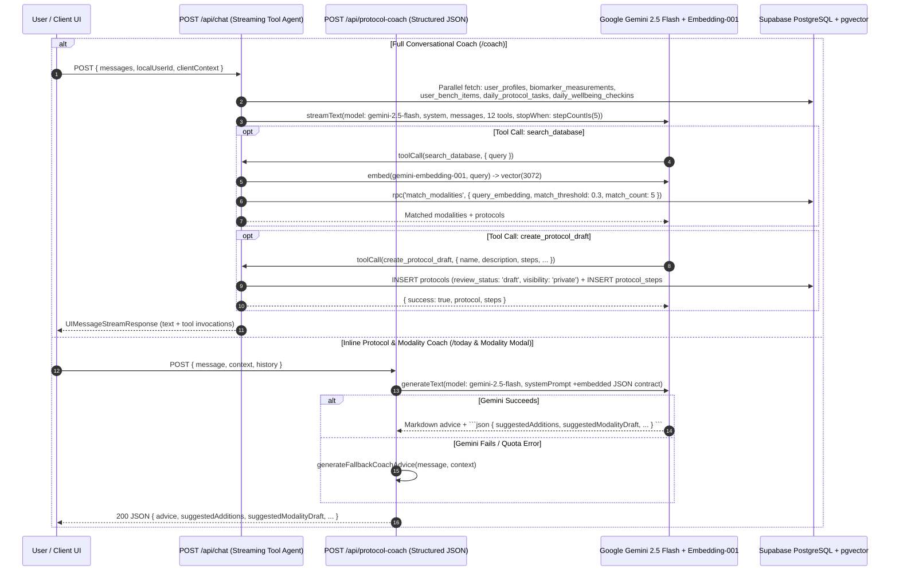
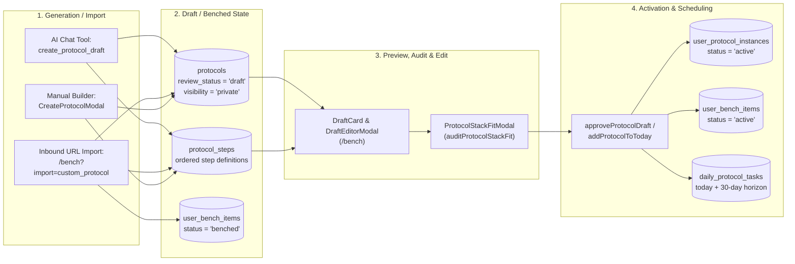
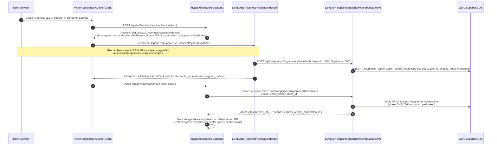

# LEVL → HyperAbundance Integration Discovery

> **Audit Scope & Verification Basis**
> - **Repository Audited**: `/Users/kylenmcclintock/Documents/AntiGravity Projects/New LEVL Protocols App`
> - **Mode**: Read-only technical discovery. No application code, database schemas, authentication configurations, or deployments were modified.
> - **Security & Privacy**: Zero secrets, API keys, tokens, or real user health records are exposed in this report. Only environment variable **names** and **synthetic examples** are used.
> - **Live Supabase & Deployment Notice**: Direct access to the remote cloud-hosted Supabase project dashboard, live `pg_catalog` / `pg_policies`, and live Vercel project settings is **unavailable** from local workspace inspection (`UNKNOWN`). Repository SQL migrations in `supabase/migrations/` and manual SQL scripts in `docs/` are cited as `VERIFIED IN CODE`, **not** as proof that the live production database matches them (`UNKNOWN` in deployed Supabase).

---

## A. Executive Summary: What Is Reusable Today and What Must Be Built

### 1. Reusable Today (`VERIFIED IN CODE`)
1. **Rich Scientific Knowledge Base, Evidence Engine, & Vector Search**:
   - **Static + Remote Catalogs**: Over 100+ longevity modalities, canonical protocols (Bryan Johnson Blueprint, Andrew Huberman, Peter Attia, Rhonda Patrick, etc.), peptide protocols, skin cycling protocols, and 8-vector biological longevity outcome evaluations are maintained in [`lib/data/index.ts`](file:///Users/kylenmcclintock/Documents/AntiGravity%20Projects/New%20LEVL%20Protocols%20App/lib/data/index.ts#L1-L670), [`lib/data/evidenceEngine.ts`](file:///Users/kylenmcclintock/Documents/AntiGravity%20Projects/New%20LEVL%20Protocols%20App/lib/data/evidenceEngine.ts), [`lib/data/studiesData.ts`](file:///Users/kylenmcclintock/Documents/AntiGravity%20Projects/New%20LEVL%20Protocols%20App/lib/data/studiesData.ts), [`lib/data/studiesExtended.ts`](file:///Users/kylenmcclintock/Documents/AntiGravity%20Projects/New%20LEVL%20Protocols%20App/lib/data/studiesExtended.ts), and [`lib/data/longevityKnowledgeBase.ts`](file:///Users/kylenmcclintock/Documents/AntiGravity%20Projects/New%20LEVL%20Protocols%20App/lib/data/longevityKnowledgeBase.ts).
   - **Semantic Search RPC**: [`searchModalitiesVector`](file:///Users/kylenmcclintock/Documents/AntiGravity%20Projects/New%20LEVL%20Protocols%20App/app/actions/search.ts#L22-L70) and the `search_database` tool inside [`POST /api/chat`](file:///Users/kylenmcclintock/Documents/AntiGravity%20Projects/New%20LEVL%20Protocols%20App/app/api/chat/route.ts#L172-L203) embed queries with Google `gemini-embedding-001` (3,072 dimensions) and call the Supabase `match_modalities` RPC ([`0004_fix_vector_dimensions.sql`](file:///Users/kylenmcclintock/Documents/AntiGravity%20Projects/New%20LEVL%20Protocols%20App/supabase/migrations/0004_fix_vector_dimensions.sql#L1-L39), [`0014_update_search_threshold.sql`](file:///Users/kylenmcclintock/Documents/AntiGravity%20Projects/New%20LEVL%20Protocols%20App/supabase/migrations/0014_update_search_threshold.sql#L1-L35)).
2. **Dual AI Coach Engines (`POST /api/chat` and `POST /api/protocol-coach`)**:
   - [`POST /api/chat`](file:///Users/kylenmcclintock/Documents/AntiGravity%20Projects/New%20LEVL%20Protocols%20App/app/api/chat/route.ts#L13-L869) provides multi-step tool-calling streaming conversations using Vercel AI SDK 6 (`streamText` + `google('gemini-2.5-flash')`) with 12 built-in tools (`search_database`, `create_protocol_draft`, `create_modality_draft`, `present_protocol`, `present_modality`, `ask_user_options`, etc.).
   - [`POST /api/protocol-coach`](file:///Users/kylenmcclintock/Documents/AntiGravity%20Projects/New%20LEVL%20Protocols%20App/app/api/protocol-coach/route.ts#L6-L369) provides synchronous structured JSON coaching (`generateText` + `google('gemini-2.5-flash')`) with a deterministic non-LLM fallback ([`generateFallbackCoachAdvice`](file:///Users/kylenmcclintock/Documents/AntiGravity%20Projects/New%20LEVL%20Protocols%20App/app/api/protocol-coach/route.ts#L247-L368)).
3. **Deterministic Contraindication & Stack Synergy Auditing**:
   - [`evaluateModalityContraindications`](file:///Users/kylenmcclintock/Documents/AntiGravity%20Projects/New%20LEVL%20Protocols%20App/lib/safety/contraindicationEngine.ts#L6-L140), [`POST /api/assess-safety`](file:///Users/kylenmcclintock/Documents/AntiGravity%20Projects/New%20LEVL%20Protocols%20App/app/api/assess-safety/route.ts#L1-L73), and [`auditProtocolStackFit`](file:///Users/kylenmcclintock/Documents/AntiGravity%20Projects/New%20LEVL%20Protocols%20App/lib/synergy/protocolStackFitAuditor.ts) check medications, conditions, timing collisions, and biochemical conflicts.
4. **Inbound Deep Links & URL-Driven Draft Import (`LongevityReviews.org` Pattern)**:
   - [`app/bench/page.tsx`](file:///Users/kylenmcclintock/Documents/AntiGravity%20Projects/New%20LEVL%20Protocols%20App/app/bench/page.tsx#L317-L448) already parses URL query parameters (`?import=custom_protocol&title=...&modalities=...&slots=...&doses=...&goal=...` and `?addModality=...`) to import external multi-modality custom protocols or single modalities directly into a user's LEVL Bench and `protocols` / `protocol_steps` tables.
   - [`app/protocols/[id]/page.tsx`](file:///Users/kylenmcclintock/Documents/AntiGravity%20Projects/New%20LEVL%20Protocols%20App/app/protocols/%5Bid%5D/page.tsx#L275-L311) already supports `?ref=<source>&influencer=<handle>&addNext=<slug>&timeBudget=<budget>` with an attribution banner and 1-click "Instant Launch" or stack-fit audit modal ([`handleEnrollClick`](file:///Users/kylenmcclintock/Documents/AntiGravity%20Projects/New%20LEVL%20Protocols%20App/app/protocols/%5Bid%5D/page.tsx#L702-L722)).

### 2. What Must Be Built or Hardened (`PROPOSED`)
1. **Cross-App Account Linking & Scoped Authorization (`PROPOSED`)**:
   - LEVL currently has **no** OAuth2 provider endpoint, **no** cross-app account-linking handshake, and **no** scoped integration token table (`VERIFIED IN CODE`).
   - Crucially, [`POST /api/chat`](file:///Users/kylenmcclintock/Documents/AntiGravity%20Projects/New%20LEVL%20Protocols%20App/app/api/chat/route.ts#L15) and [`POST /api/protocol-coach`](file:///Users/kylenmcclintock/Documents/AntiGravity%20Projects/New%20LEVL%20Protocols%20App/app/api/protocol-coach/route.ts#L9) currently accept an unverified `localUserId` in the JSON body without validating a Supabase JWT (`VERIFIED IN CODE`). Before exposing LEVL APIs cross-origin to the HyperAbundance Atrium, LEVL must enforce cryptographic token verification.
2. **External Integration API Routes (`/api/integrations/hyperabundance/*`) (`PROPOSED`)**:
   - Dedicated CORS-enabled, rate-limited endpoints for:
     1. Public/connected "Protocol Bartender" Q&A + custom persona injection (`bartender` / `spa_guide`) without mutating live schedules during exploration.
     2. Pure draft creation (fixing a current side-effect in `create_modality_draft` which writes directly to `daily_protocol_tasks` for 30 days).
     3. Authorized draft saving to a linked LEVL account (`protocols` with `review_status = 'draft'` + `user_bench_items` with `status = 'benched'`) returning a canonical deep link to open/review in LEVL.
3. **Database RLS, Guest-to-Auth Migration, & Account Deletion Fixes (`PROPOSED`)**:
   - Fix [`linkGuestDataToAuthUser`](file:///Users/kylenmcclintock/Documents/AntiGravity%20Projects/New%20LEVL%20Protocols%20App/lib/auth/linkGuestData.ts#L9-L300) so draft `protocols` and custom `modalities` created while signed out migrate when the user signs in.
   - Fix [`POST /api/user/delete-account`](file:///Users/kylenmcclintock/Documents/AntiGravity%20Projects/New%20LEVL%20Protocols%20App/app/api/user/delete-account/route.ts#L57-L109) which currently filters by `user_id` instead of `local_user_id` on several tables.
4. **Community & Discord Separation (`PROPOSED` in Habitat Repository)**:
   - LEVL has **zero** Discord SDK, webhook, or multi-user chat room code (`VERIFIED IN CODE`). All Discord integration should live exclusively in the HyperAbundance repository, restricted to public Atrium channels, while LEVL coach/protocol API calls remain isolated to private per-user sessions.

---

## B. Current Architecture and End-to-End Coach/Protocol Flow

### 1. Architecture and Deployment

#### Framework, Languages, & Packages (`VERIFIED IN CODE`)
- **Framework**: Next.js `16.2.7` using the App Router (`app/`), React `19.2.4`, TypeScript `^5`, Tailwind CSS v4 (`@tailwindcss/postcss` `^4`), and Turbopack (`next dev --turbopack` in [`package.json`](file:///Users/kylenmcclintock/Documents/AntiGravity%20Projects/New%20LEVL%20Protocols%20App/package.json#L6-L37)).
- **AI & LLM SDKs**:
  - `ai` (`^6.0.197`) — Vercel AI SDK 6 core (`streamText`, `generateText`, `tool`, `embed`, `stepCountIs`).
  - `@ai-sdk/google` (`^3.0.80`) — Google Generative AI provider (`gemini-2.5-flash` and `gemini-embedding-001`).
  - `@ai-sdk/react` (`^3.0.199`) — React `useChat` hook used with `DefaultChatTransport`.
  - `@google/genai` (`^1.49.0`) — Installed in [`package.json`](file:///Users/kylenmcclintock/Documents/AntiGravity%20Projects/New%20LEVL%20Protocols%20App/package.json#L16) (used by standalone scripts; app routes use `@ai-sdk/google`).
- **Backend & Data**:
  - `@supabase/supabase-js` (`^2.107.0`) — Browser/server Supabase client ([`lib/supabase/client.ts`](file:///Users/kylenmcclintock/Documents/AntiGravity%20Projects/New%20LEVL%20Protocols%20App/lib/supabase/client.ts#L1-L16)).
  - `zod` (`^4.4.3`) — Tool parameter validation schemas.
  - `date-fns` (`^4.4.0`), `lucide-react` (`^1.16.0`).
- **Mobile Packaging**:
  - `@capacitor/core`, `@capacitor/ios`, `@capacitor/android` (`^8.3.0`). Configured in [`capacitor.config.ts`](file:///Users/kylenmcclintock/Documents/AntiGravity%20Projects/New%20LEVL%20Protocols%20App/capacitor.config.ts#L1-L40) with `appId: 'app.levlprotocols.longevity'`, `appName: 'LEVL'`, `webDir: 'public'`, and default remote server URL `https://levlprotocols.app`.

#### Repository Structure (`VERIFIED IN CODE`)
- [`app/`](file:///Users/kylenmcclintock/Documents/AntiGravity%20Projects/New%20LEVL%20Protocols%20App/app): Next.js App Router pages (`/today`, `/coach`, `/bench`, `/explore`, `/protocols/[id]`, `/modalities/[id]`, `/labs`, `/outcomes`, `/profile`, `/onboarding`, `/auth/callback`, `/privacy`, `/terms`) and backend API route handlers (`app/api/*`) plus Server Actions ([`app/actions/search.ts`](file:///Users/kylenmcclintock/Documents/AntiGravity%20Projects/New%20LEVL%20Protocols%20App/app/actions/search.ts)).
- [`components/`](file:///Users/kylenmcclintock/Documents/AntiGravity%20Projects/New%20LEVL%20Protocols%20App/components): UI components, including AI chat bars (`components/ai/`), protocol/draft cards (`components/cards/`), modals (`components/modals/`), and detail drawers (`components/views/`).
- [`contexts/`](file:///Users/kylenmcclintock/Documents/AntiGravity%20Projects/New%20LEVL%20Protocols%20App/contexts): [`AuthContext.tsx`](file:///Users/kylenmcclintock/Documents/AntiGravity%20Projects/New%20LEVL%20Protocols%20App/contexts/AuthContext.tsx) and [`ThemeContext.tsx`](file:///Users/kylenmcclintock/Documents/AntiGravity%20Projects/New%20LEVL%20Protocols%20App/contexts/ThemeContext.tsx).
- [`lib/`](file:///Users/kylenmcclintock/Documents/AntiGravity%20Projects/New%20LEVL%20Protocols%20App/lib):
  - [`lib/data/index.ts`](file:///Users/kylenmcclintock/Documents/AntiGravity%20Projects/New%20LEVL%20Protocols%20App/lib/data/index.ts): 10,788-line central data access layer, in-memory/localStorage SWR caching, schedule hydration, and task reconciliation engine.
  - [`lib/data/*`](file:///Users/kylenmcclintock/Documents/AntiGravity%20Projects/New%20LEVL%20Protocols%20App/lib/data): Static TypeScript catalogs for canonical protocols, modalities, studies, PubMed references, and evidence scoring.
  - [`lib/types/index.ts`](file:///Users/kylenmcclintock/Documents/AntiGravity%20Projects/New%20LEVL%20Protocols%20App/lib/types/index.ts): Canonical TypeScript interfaces.
  - [`lib/safety/contraindicationEngine.ts`](file:///Users/kylenmcclintock/Documents/AntiGravity%20Projects/New%20LEVL%20Protocols%20App/lib/safety/contraindicationEngine.ts), [`lib/synergy/`](file:///Users/kylenmcclintock/Documents/AntiGravity%20Projects/New%20LEVL%20Protocols%20App/lib/synergy), [`lib/aging-models/`](file:///Users/kylenmcclintock/Documents/AntiGravity%20Projects/New%20LEVL%20Protocols%20App/lib/aging-models), [`lib/scoring/`](file:///Users/kylenmcclintock/Documents/AntiGravity%20Projects/New%20LEVL%20Protocols%20App/lib/scoring).
- [`supabase/migrations/`](file:///Users/kylenmcclintock/Documents/AntiGravity%20Projects/New%20LEVL%20Protocols%20App/supabase/migrations): 18 SQL migration files (`0001_initial_schema.sql` through `0018_canonical_longevity_architecture.sql`).
- [`services/`](file:///Users/kylenmcclintock/Documents/AntiGravity%20Projects/New%20LEVL%20Protocols%20App/services): Legacy stub files (`coachStub.ts`, `modalityQuestionStub.ts`, `bloodworkStub.ts`, `longevityScoreStub.ts`, `wearableStub.ts`).

#### Hosting & Backend Services (`VERIFIED IN CODE` / `VERIFIED IN DEPLOYED CONFIGURATION`)
- **Web & API Hosting**: Vercel (`.vercel` project directory present; `VERCEL_OIDC_TOKEN` present in `.env.local` — `VERIFIED IN DEPLOYED CONFIGURATION`).
- **Database & Auth**: Remote cloud-hosted Supabase project (`NEXT_PUBLIC_SUPABASE_URL` present in `.env.local` — `VERIFIED IN DEPLOYED CONFIGURATION`).
- **Supabase Feature Breakdown (`VERIFIED IN CODE`)**:
  - **Database (PostgreSQL)**: Heavily used across all tables (`modalities`, `protocols`, `protocol_steps`, `user_profiles`, `user_bench_items`, `user_protocol_instances`, `daily_protocol_tasks`, `daily_wellbeing_checkins`, `outcome_observations`, `user_lab_panels`, `biomarker_measurements`, `bioage_calculation_logs`, `modality_claims`, `modality_sources`, `modality_relationships`, `daily_sessions`).
  - **Auth**: Supabase Auth used for Google OAuth, Apple OAuth, Google ID Token, and Email OTP Magic Links ([`contexts/AuthContext.tsx`](file:///Users/kylenmcclintock/Documents/AntiGravity%20Projects/New%20LEVL%20Protocols%20App/contexts/AuthContext.tsx#L131-L210)).
  - **Vector Search (`pgvector`)**: Enabled via `create extension if not exists vector` in [`0003_add_vector_search.sql`](file:///Users/kylenmcclintock/Documents/AntiGravity%20Projects/New%20LEVL%20Protocols%20App/supabase/migrations/0003_add_vector_search.sql#L2), upgraded to `vector(3072)` in [`0004_fix_vector_dimensions.sql`](file:///Users/kylenmcclintock/Documents/AntiGravity%20Projects/New%20LEVL%20Protocols%20App/supabase/migrations/0004_fix_vector_dimensions.sql#L7), queried via `supabase.rpc('match_modalities', ...)` in [`app/actions/search.ts`](file:///Users/kylenmcclintock/Documents/AntiGravity%20Projects/New%20LEVL%20Protocols%20App/app/actions/search.ts#L34-L38) and [`app/api/chat/route.ts`](file:///Users/kylenmcclintock/Documents/AntiGravity%20Projects/New%20LEVL%20Protocols%20App/app/api/chat/route.ts#L186-L190).
  - **Storage**: **Not used** (`VERIFIED IN CODE`). Lab PDFs/images, supplement bottle photos, meal photos, and physique photos are sent as base64 strings directly to Next.js API routes for Gemini multimodal extraction; physique photos are stored locally in `localStorage` (`levl_physique_logs_v1`).
  - **Realtime**: **Not used** (`VERIFIED IN CODE`). Zero `.channel()` or `.on('postgres_changes')` calls exist in the codebase. Cross-component reactivity uses browser `CustomEvent` broadcasts (`levl_tasks_updated`, `levl_bench_updated`, `levl_schedule_updated`, `levl_task_status_changed`).
  - **Edge Functions**: **Not used** (`VERIFIED IN CODE`). No `supabase/functions/` directory exists; all serverless compute runs in Next.js App Router API routes (`app/api/*`).
  - **Scheduled Jobs (`pg_cron` / Vercel Cron)**: **Not used** (`VERIFIED IN CODE`). Daily task rollover (`processSnoozedTasksRollover`) and future task materialization run lazily on the client when the user opens the app ([`lib/data/index.ts`](file:///Users/kylenmcclintock/Documents/AntiGravity%20Projects/New%20LEVL%20Protocols%20App/lib/data/index.ts#L1808-L2024)).

#### Environment Variable Names Only (`VERIFIED IN CODE` & `VERIFIED IN DEPLOYED CONFIGURATION`)
- Referenced in code (`process.env.*`) and/or present in `.env.local` (values omitted):
  - `NEXT_PUBLIC_SUPABASE_URL` ([`lib/supabase/client.ts`](file:///Users/kylenmcclintock/Documents/AntiGravity%20Projects/New%20LEVL%20Protocols%20App/lib/supabase/client.ts#L3), [`app/api/user/delete-account/route.ts`](file:///Users/kylenmcclintock/Documents/AntiGravity%20Projects/New%20LEVL%20Protocols%20App/app/api/user/delete-account/route.ts#L6))
  - `NEXT_PUBLIC_SUPABASE_ANON_KEY` ([`lib/supabase/client.ts`](file:///Users/kylenmcclintock/Documents/AntiGravity%20Projects/New%20LEVL%20Protocols%20App/lib/supabase/client.ts#L4), [`app/api/user/delete-account/route.ts`](file:///Users/kylenmcclintock/Documents/AntiGravity%20Projects/New%20LEVL%20Protocols%20App/app/api/user/delete-account/route.ts#L7))
  - `SUPABASE_SERVICE_ROLE_KEY` ([`app/api/user/delete-account/route.ts`](file:///Users/kylenmcclintock/Documents/AntiGravity%20Projects/New%20LEVL%20Protocols%20App/app/api/user/delete-account/route.ts#L8), seed scripts in `scripts/`)
  - `GOOGLE_GENERATIVE_AI_API_KEY` (implicitly read by `@ai-sdk/google` in all AI routes and checked in [`app/api/protocol-coach/route.ts`](file:///Users/kylenmcclintock/Documents/AntiGravity%20Projects/New%20LEVL%20Protocols%20App/app/api/protocol-coach/route.ts#L28))
  - `NEXT_PUBLIC_GOOGLE_CLIENT_ID` (present in `.env.local` for Google One-Tap / ID token auth)
  - `CAPACITOR_SERVER_URL` ([`capacitor.config.ts`](file:///Users/kylenmcclintock/Documents/AntiGravity%20Projects/New%20LEVL%20Protocols%20App/capacitor.config.ts#L17))
  - `VERCEL_OIDC_TOKEN` (present in `.env.local`, managed by Vercel CLI)

#### Deployed Functionality vs. Stubs, Mocks, & Unfinished Code (`VERIFIED IN CODE`)
| Subsystem | Status | Evidence in Codebase |
| :--- | :--- | :--- |
| Primary AI Coach (`/coach` + `POST /api/chat`) | **Production / Active** | [`app/coach/page.tsx`](file:///Users/kylenmcclintock/Documents/AntiGravity%20Projects/New%20LEVL%20Protocols%20App/app/coach/page.tsx), [`app/api/chat/route.ts`](file:///Users/kylenmcclintock/Documents/AntiGravity%20Projects/New%20LEVL%20Protocols%20App/app/api/chat/route.ts) |
| Inline Today & Modality Coach (`POST /api/protocol-coach`) | **Production / Active** | [`components/ai/LongevityCoachInputBar.tsx`](file:///Users/kylenmcclintock/Documents/AntiGravity%20Projects/New%20LEVL%20Protocols%20App/components/ai/LongevityCoachInputBar.tsx), [`components/ai/ModalityAICoachBar.tsx`](file:///Users/kylenmcclintock/Documents/AntiGravity%20Projects/New%20LEVL%20Protocols%20App/components/ai/ModalityAICoachBar.tsx), [`app/api/protocol-coach/route.ts`](file:///Users/kylenmcclintock/Documents/AntiGravity%20Projects/New%20LEVL%20Protocols%20App/app/api/protocol-coach/route.ts) |
| Protocol & Modality Catalog, Bench, Schedule, & Today Timeline | **Production / Active** | [`lib/data/index.ts`](file:///Users/kylenmcclintock/Documents/AntiGravity%20Projects/New%20LEVL%20Protocols%20App/lib/data/index.ts), [`app/today/page.tsx`](file:///Users/kylenmcclintock/Documents/AntiGravity%20Projects/New%20LEVL%20Protocols%20App/app/today/page.tsx), [`app/bench/page.tsx`](file:///Users/kylenmcclintock/Documents/AntiGravity%20Projects/New%20LEVL%20Protocols%20App/app/bench/page.tsx) |
| Legacy AI / Wearable / Bloodwork Stubs in `services/` | **Unused Legacy Mocks** | [`services/ai/coachStub.ts`](file:///Users/kylenmcclintock/Documents/AntiGravity%20Projects/New%20LEVL%20Protocols%20App/services/ai/coachStub.ts), [`services/wearables/wearableStub.ts`](file:///Users/kylenmcclintock/Documents/AntiGravity%20Projects/New%20LEVL%20Protocols%20App/services/wearables/wearableStub.ts), [`services/bloodwork/bloodworkStub.ts`](file:///Users/kylenmcclintock/Documents/AntiGravity%20Projects/New%20LEVL%20Protocols%20App/services/bloodwork/bloodworkStub.ts) |
| Device Passkey Lock (`lib/auth/passkeyEngine.ts`) | **Client-Only UI Lock (Not Server Auth)** | [`lib/auth/passkeyEngine.ts`](file:///Users/kylenmcclintock/Documents/AntiGravity%20Projects/New%20LEVL%20Protocols%20App/lib/auth/passkeyEngine.ts#L84-L163) verifies WebAuthn locally against `localStorage['levl_passkey_data']` using a random client challenge; does not create a Supabase Auth session. |

---

### 2. AI Coach Deep Dive (`VERIFIED IN CODE`)

LEVL has **two** distinct AI Coach implementations that serve different UX surfaces:



#### Flow 1: Full Conversational Coach (`POST /api/chat`)
1. **Client Entry ([`app/coach/page.tsx`](file:///Users/kylenmcclintock/Documents/AntiGravity%20Projects/New%20LEVL%20Protocols%20App/app/coach/page.tsx#L247-L296))**:
   - Uses `useChat` from `@ai-sdk/react` with `DefaultChatTransport({ api: '/api/chat' })`.
   - Before sending a message, [`checkAndGateAiConsent`](file:///Users/kylenmcclintock/Documents/AntiGravity%20Projects/New%20LEVL%20Protocols%20App/app/coach/page.tsx#L276-L283) checks [`hasAiDataConsent()`](file:///Users/kylenmcclintock/Documents/AntiGravity%20Projects/New%20LEVL%20Protocols%20App/lib/compliance/aiConsent.ts#L8-L16) (`localStorage['levl_ai_data_consent_v1'] === 'granted'`). If not granted, it opens [`AiDataConsentModal`](file:///Users/kylenmcclintock/Documents/AntiGravity%20Projects/New%20LEVL%20Protocols%20App/components/modals/AiDataConsentModal.tsx#L14-L86).
   - [`sendWithContext`](file:///Users/kylenmcclintock/Documents/AntiGravity%20Projects/New%20LEVL%20Protocols%20App/app/coach/page.tsx#L266-L274) calls `sendMessage({ text }, { body: { localUserId: getEffectiveUserId(), clientContext: buildClientContext() } })`.
   - [`buildClientContext`](file:///Users/kylenmcclintock/Documents/AntiGravity%20Projects/New%20LEVL%20Protocols%20App/app/coach/page.tsx#L194-L245) bundles the client's cached profile (age, biological sex, height, weight, sleep schedule, health conditions, medications, top outcome goals), today's tasks, bench items, and latest wellbeing check-in.
2. **Server Context Assembly ([`app/api/chat/route.ts`](file:///Users/kylenmcclintock/Documents/AntiGravity%20Projects/New%20LEVL%20Protocols%20App/app/api/chat/route.ts#L13-L148))**:
   - Parses `{ messages, localUserId, clientContext }`.
   - Normalizes message parts for Vercel AI SDK 6 compatibility ([`app/api/chat/route.ts`](file:///Users/kylenmcclintock/Documents/AntiGravity%20Projects/New%20LEVL%20Protocols%20App/app/api/chat/route.ts#L17-L42)).
   - If `supabase` is configured and `localUserId` is truthy, runs 5 parallel Supabase queries ([`app/api/chat/route.ts`](file:///Users/kylenmcclintock/Documents/AntiGravity%20Projects/New%20LEVL%20Protocols%20App/app/api/chat/route.ts#L50-L56)):
     - `user_profiles` (`.eq('local_user_id', localUserId)`)
     - `biomarker_measurements` (`.eq('user_id', localUserId)`, up to 30 latest labs)
     - `user_bench_items` (`.eq('local_user_id', localUserId)`, joined with `modality:modalities(name, category)`)
     - `daily_protocol_tasks` (`.eq('local_user_id', localUserId).eq('scheduled_date', todayStr)`)
     - `daily_wellbeing_checkins` (`.eq('local_user_id', localUserId)`, latest 5 check-ins)
   - Merges DB rows with `clientContext` fallback and formats a structured `[USER HEALTH & BIOMARKER CONTEXT]` block injected into the system prompt ([`app/api/chat/route.ts`](file:///Users/kylenmcclintock/Documents/AntiGravity%20Projects/New%20LEVL%20Protocols%20App/app/api/chat/route.ts#L58-L143)).
3. **Model Provider, System Prompt, & Tool Definitions ([`app/api/chat/route.ts`](file:///Users/kylenmcclintock/Documents/AntiGravity%20Projects/New%20LEVL%20Protocols%20App/app/api/chat/route.ts#L150-L855))**:
   - Calls `streamText` with `model: google('gemini-2.5-flash')` and `stopWhen: stepCountIs(5)`.
   - Exposes **12 tools**:
     1. `search_database` ([L172-L203](file:///Users/kylenmcclintock/Documents/AntiGravity%20Projects/New%20LEVL%20Protocols%20App/app/api/chat/route.ts#L172-L203)): Generates embedding via `embed({ model: google.textEmbeddingModel('gemini-embedding-001'), value: query })`, calls `supabase.rpc('match_modalities', { query_embedding, match_threshold: 0.3, match_count: 5 })`, and queries `protocols` via `ilike`.
     2. `create_modality_draft` ([L204-L361](file:///Users/kylenmcclintock/Documents/AntiGravity%20Projects/New%20LEVL%20Protocols%20App/app/api/chat/route.ts#L204-L361)): **Important side-effect warning**: Despite being named `create_modality_draft`, when `add_to_today !== false` (the default), it immediately inserts a row into `modalities` (`status: 'active'`, `visibility: 'private'`), inserts 31 rows into `daily_protocol_tasks` (today + next 30 days), and inserts an active row into `user_bench_items`!
     3. `create_protocol_draft` ([L362-L545](file:///Users/kylenmcclintock/Documents/AntiGravity%20Projects/New%20LEVL%20Protocols%20App/app/api/chat/route.ts#L362-L545)): Resolves or creates step modalities, inserts a row into `protocols` with `review_status: 'draft'`, `visibility: 'private'`, `local_user_id: localUserId`, and inserts steps into `protocol_steps`. Does **not** schedule tasks on the user's calendar until the user later approves/activates the draft.
     4. `add_to_bench` ([L546-L609](file:///Users/kylenmcclintock/Documents/AntiGravity%20Projects/New%20LEVL%20Protocols%20App/app/api/chat/route.ts#L546-L609)): Adds a modality or protocol's steps to `user_bench_items` with `status: 'benched'`.
     5. `add_to_today` ([L610-L686](file:///Users/kylenmcclintock/Documents/AntiGravity%20Projects/New%20LEVL%20Protocols%20App/app/api/chat/route.ts#L610-L686)): Schedules a modality or protocol onto `daily_protocol_tasks` for today.
     6. `update_profile_inline` ([L687-L716](file:///Users/kylenmcclintock/Documents/AntiGravity%20Projects/New%20LEVL%20Protocols%20App/app/api/chat/route.ts#L687-L716)): Returns a UI card payload to update age, sex, weight, wake/bed time, conditions, or medications.
     7. `ask_user_options` ([L717-L731](file:///Users/kylenmcclintock/Documents/AntiGravity%20Projects/New%20LEVL%20Protocols%20App/app/api/chat/route.ts#L717-L731)): Renders interactive multiple-choice clarifying pills in the chat UI.
     8. `present_modality` ([L732-L760](file:///Users/kylenmcclintock/Documents/AntiGravity%20Projects/New%20LEVL%20Protocols%20App/app/api/chat/route.ts#L732-L760)): Renders an interactive modality preview card with "Add to Today" / "Save to Bench" buttons.
     9. `present_protocol` ([L761-L785](file:///Users/kylenmcclintock/Documents/AntiGravity%20Projects/New%20LEVL%20Protocols%20App/app/api/chat/route.ts#L761-L785)): Renders an interactive protocol preview card with steps.
     10. `remove_from_today` ([L786-L810](file:///Users/kylenmcclintock/Documents/AntiGravity%20Projects/New%20LEVL%20Protocols%20App/app/api/chat/route.ts#L786-L810)): Deletes today's pending task for a modality.
     11. `move_to_bench` ([L811-L835](file:///Users/kylenmcclintock/Documents/AntiGravity%20Projects/New%20LEVL%20Protocols%20App/app/api/chat/route.ts#L811-L835)): Moves a modality from today's active schedule to `user_bench_items` (`status: 'benched'`).
     12. `eliminate_modality` ([L836-L853](file:///Users/kylenmcclintock/Documents/AntiGravity%20Projects/New%20LEVL%20Protocols%20App/app/api/chat/route.ts#L836-L853)): Marks a modality as `status: 'eliminated'` on `user_bench_items` and deletes today's task.
4. **Streaming Format & Conversation Storage**:
   - Returns `result.toUIMessageStreamResponse()` ([`app/api/chat/route.ts`](file:///Users/kylenmcclintock/Documents/AntiGravity%20Projects/New%20LEVL%20Protocols%20App/app/api/chat/route.ts#L857)) using the Vercel AI SDK 6 UIMessage SSE stream format.
   - **Memory / Persistence**: Conversation history on `/coach` is held **only in React state** (`useChat` in [`app/coach/page.tsx`](file:///Users/kylenmcclintock/Documents/AntiGravity%20Projects/New%20LEVL%20Protocols%20App/app/coach/page.tsx#L251)) and is **not** stored in Supabase (`VERIFIED IN CODE`). Long-term memory comes from re-querying the user's profile, biomarkers, bench items, tasks, and wellbeing check-ins on every turn.

#### Flow 2: Inline Protocol & Modality Coach (`POST /api/protocol-coach`)
1. **Entry Points**:
   - [`LongevityCoachInputBar.tsx`](file:///Users/kylenmcclintock/Documents/AntiGravity%20Projects/New%20LEVL%20Protocols%20App/components/ai/LongevityCoachInputBar.tsx#L210-L239) on `/today` (stores thread in `sessionStorage['levl_today_coach_thread']`).
   - [`ModalityAICoachBar.tsx`](file:///Users/kylenmcclintock/Documents/AntiGravity%20Projects/New%20LEVL%20Protocols%20App/components/ai/ModalityAICoachBar.tsx#L156-L185) inside `DosageDetailModal` / `ScheduleModalityModal`.
2. **Execution ([`app/api/protocol-coach/route.ts`](file:///Users/kylenmcclintock/Documents/AntiGravity%20Projects/New%20LEVL%20Protocols%20App/app/api/protocol-coach/route.ts#L6-L241))**:
   - Stateless `POST` accepting `{ message, context, history }`. Does **not** query Supabase directly; relies entirely on the `context` object passed by the caller (`modalityName`, `currentDose`, `currentTiming`, `activeStackNames`, `userProfile`, `recentCheckins`, `availableCatalog`).
   - Calls `generateText({ model: google('gemini-2.5-flash'), prompt })` with `maxDuration = 30`.
   - Extracts an embedded ```` ```json ... ``` ```` block from the model's response and returns structured suggestions (`advice`, `suggestedAdditions`, `suggestedRemovals`, `suggestedDose`, `suggestedTiming`, `suggestedDosesPerDay`, `suggestedTimingSlots`, `suggestedScheduleMode`, `suggestedDays`, `suggestedRestIntervalDays`, `suggestedAdaptationStrategy`, `suggestedNotes`, `suggestedModalityDraft`, `synergyHighlight`, `scientificPushback`).
   - If `GOOGLE_GENERATIVE_AI_API_KEY` is missing or Gemini throws an error/quota failure, falls back deterministically to [`generateFallbackCoachAdvice`](file:///Users/kylenmcclintock/Documents/AntiGravity%20Projects/New%20LEVL%20Protocols%20App/app/api/protocol-coach/route.ts#L247-L368).

#### Coupling, Limits, Quotas, & Persona Customization (`VERIFIED IN CODE`)
- **Coupling**: [`POST /api/protocol-coach`](file:///Users/kylenmcclintock/Documents/AntiGravity%20Projects/New%20LEVL%20Protocols%20App/app/api/protocol-coach/route.ts) is 100% decoupled from the UI and database (pure JSON in, JSON out). [`POST /api/chat`](file:///Users/kylenmcclintock/Documents/AntiGravity%20Projects/New%20LEVL%20Protocols%20App/app/api/chat/route.ts) is callable via standard HTTP POST, but several of its tools (`create_modality_draft`, `add_to_today`, `remove_from_today`) mutate the user's live schedule immediately during tool execution.
- **Quotas, Rate Limits, & Cost Tracking**: **None exist in code** (`VERIFIED IN CODE`). Aside from `export const maxDuration = 30` on `/api/protocol-coach`, `/api/labs/upload`, `/api/physique/analyze`, and `/api/nutrition/scan`, there is no Upstash/Redis rate limiter, no per-user token budget, and no LLM token/cost logging table.
- **Persona Customization**:
  - [`POST /api/voice/log`](file:///Users/kylenmcclintock/Documents/AntiGravity%20Projects/New%20LEVL%20Protocols%20App/app/api/voice/log/route.ts#L118-L126) already implements a `persona` switch (`coach`, `friend`, `scientist`, `trainer`, `minimalist`) that swaps the system prompt persona instructions while keeping the extraction schema identical.
  - Neither `/api/chat` nor `/api/protocol-coach` currently accepts a `persona` parameter (`VERIFIED IN CODE`), but adding an allowlisted `persona` / `venueContext` parameter (e.g., `atrium_bartender`, `virtual_spa_guide`) to their system prompt builders requires ~20 lines of code without duplicating core retrieval or tool logic (`PROPOSED`).

---

### 3. Research and Knowledge Sources (`VERIFIED IN CODE`)

#### Where Knowledge Lives
1. **Static TypeScript Catalogs (`lib/data/*`)**:
   - [`builtInLongevityModalities.ts`](file:///Users/kylenmcclintock/Documents/AntiGravity%20Projects/New%20LEVL%20Protocols%20App/lib/data/builtInLongevityModalities.ts) & [`hubermanDoacModalities.ts`](file:///Users/kylenmcclintock/Documents/AntiGravity%20Projects/New%20LEVL%20Protocols%20App/lib/data/hubermanDoacModalities.ts): Core longevity modalities with 8-vector `functional_impacts`, `hallmarks_of_aging_impact`, dosing profiles (`dosage_options`), `contraindications`, and `evidence_sources`.
   - [`builtInCanonicalProtocols.ts`](file:///Users/kylenmcclintock/Documents/AntiGravity%20Projects/New%20LEVL%20Protocols%20App/lib/data/builtInCanonicalProtocols.ts), [`builtInFunctionalProtocols.ts`](file:///Users/kylenmcclintock/Documents/AntiGravity%20Projects/New%20LEVL%20Protocols%20App/lib/data/builtInFunctionalProtocols.ts), [`builtInPeptideProtocols.ts`](file:///Users/kylenmcclintock/Documents/AntiGravity%20Projects/New%20LEVL%20Protocols%20App/lib/data/builtInPeptideProtocols.ts), [`builtInSkinProtocols.ts`](file:///Users/kylenmcclintock/Documents/AntiGravity%20Projects/New%20LEVL%20Protocols%20App/lib/data/builtInSkinProtocols.ts), [`builtInTrainingProtocols.ts`](file:///Users/kylenmcclintock/Documents/AntiGravity%20Projects/New%20LEVL%20Protocols%20App/lib/data/builtInTrainingProtocols.ts), [`hubermanDoacProtocol.ts`](file:///Users/kylenmcclintock/Documents/AntiGravity%20Projects/New%20LEVL%20Protocols%20App/lib/data/hubermanDoacProtocol.ts): Complete protocol templates with steps, exact temperatures, doses, durations, and PubMed links.
   - [`evidenceEngine.ts`](file:///Users/kylenmcclintock/Documents/AntiGravity%20Projects/New%20LEVL%20Protocols%20App/lib/data/evidenceEngine.ts), [`studiesData.ts`](file:///Users/kylenmcclintock/Documents/AntiGravity%20Projects/New%20LEVL%20Protocols%20App/lib/data/studiesData.ts), [`studiesExtended.ts`](file:///Users/kylenmcclintock/Documents/AntiGravity%20Projects/New%20LEVL%20Protocols%20App/lib/data/studiesExtended.ts), [`references.ts`](file:///Users/kylenmcclintock/Documents/AntiGravity%20Projects/New%20LEVL%20Protocols%20App/lib/data/references.ts), [`longevityKnowledgeBase.ts`](file:///Users/kylenmcclintock/Documents/AntiGravity%20Projects/New%20LEVL%20Protocols%20App/lib/data/longevityKnowledgeBase.ts): Curated human RCTs, PubMed PMIDs, DOIs, evidence grades (`Grade A (Human RCT)`, `Grade B (Clinical Trial)`, etc.), and clinical effect sizes.
2. **Remote Supabase Tables**:
   - `modalities`, `protocols`, `protocol_steps` ([`0001_initial_schema.sql`](file:///Users/kylenmcclintock/Documents/AntiGravity%20Projects/New%20LEVL%20Protocols%20App/supabase/migrations/0001_initial_schema.sql)).
   - `modality_claims`, `modality_sources`, `modality_relationships` ([`0018_canonical_longevity_architecture.sql`](file:///Users/kylenmcclintock/Documents/AntiGravity%20Projects/New%20LEVL%20Protocols%20App/supabase/migrations/0018_canonical_longevity_architecture.sql#L100-L185)).

#### How Retrieval Works & How Citations Reach the User
- **Runtime Catalog Merging**: [`getModalities()`](file:///Users/kylenmcclintock/Documents/AntiGravity%20Projects/New%20LEVL%20Protocols%20App/lib/data/index.ts#L712-L795) and [`getProtocols()`](file:///Users/kylenmcclintock/Documents/AntiGravity%20Projects/New%20LEVL%20Protocols%20App/lib/data/index.ts#L825-L905) fetch remote rows from Supabase (`visibility = 'public'` or owned by `local_user_id`) and merge them with the static TypeScript catalogs via [`mergeBuiltInModalities`](file:///Users/kylenmcclintock/Documents/AntiGravity%20Projects/New%20LEVL%20Protocols%20App/lib/data/index.ts#L458-L598) and [`mergeBuiltInProtocols`](file:///Users/kylenmcclintock/Documents/AntiGravity%20Projects/New%20LEVL%20Protocols%20App/lib/data/index.ts#L600-L670).
- **Caching & Freshness**: Merged catalogs are cached in memory for 5 minutes (`CATALOG_TTL = 5 * 60 * 1000`) and in `localStorage` (`levl_cat_v3_modalities`, `levl_cat_v3_protocols_steps`) for 24 hours (`LOCAL_CATALOG_TTL = 24 * 60 * 60 * 1000` in [`lib/data/index.ts`](file:///Users/kylenmcclintock/Documents/AntiGravity%20Projects/New%20LEVL%20Protocols%20App/lib/data/index.ts#L285-L295)) with background SWR revalidation.
- **Citation Delivery**:
  - In UI drawers ([`GeekMode.tsx`](file:///Users/kylenmcclintock/Documents/AntiGravity%20Projects/New%20LEVL%20Protocols%20App/components/views/GeekMode.tsx), [`ExpandedModalityDetailBanner.tsx`](file:///Users/kylenmcclintock/Documents/AntiGravity%20Projects/New%20LEVL%20Protocols%20App/components/views/ExpandedModalityDetailBanner.tsx), [`ProtocolLongevityDrawer.tsx`](file:///Users/kylenmcclintock/Documents/AntiGravity%20Projects/New%20LEVL%20Protocols%20App/components/cards/ProtocolLongevityDrawer.tsx)), [`getModalityEvidenceStats`](file:///Users/kylenmcclintock/Documents/AntiGravity%20Projects/New%20LEVL%20Protocols%20App/lib/data/evidenceEngine.ts) resolves PubMed URLs, PMIDs, study titles, and 8-vector scores (`0–100`) from `functional_impacts` and `studiesData.ts`.
  - In AI chat (`POST /api/chat`), `search_database` returns matched rows from `match_modalities`, and the system prompt instructs Gemini to cite specific physiological mechanisms (`eNOS`, `AMPK`, `SIRT1`, `HSP70`, etc.). Note that `match_modalities` ([`0014_update_search_threshold.sql`](file:///Users/kylenmcclintock/Documents/AntiGravity%20Projects/New%20LEVL%20Protocols%20App/supabase/migrations/0014_update_search_threshold.sql#L11-L34)) currently returns only `id, name, category, description, similarity` and does **not** return `functional_impacts` or `evidence_sources` directly to the LLM tool result (`VERIFIED IN CODE`).

#### Existing Integrations with `longevityreviews.org` and `levlhealth.com` (`VERIFIED IN CODE`)
- **Shared Supabase Backend with `longevityreviews.org`**: Per [`docs/LONGEVITY_REVIEWS_ANTIGRAVITY_PROMPT.md`](file:///Users/kylenmcclintock/Documents/AntiGravity%20Projects/New%20LEVL%20Protocols%20App/docs/LONGEVITY_REVIEWS_ANTIGRAVITY_PROMPT.md#L1-L40) and [`docs/update_longevity_outcomes.sql`](file:///Users/kylenmcclintock/Documents/AntiGravity%20Projects/New%20LEVL%20Protocols%20App/docs/update_longevity_outcomes.sql#L2276), `longevityreviews.org` reads from the **same** Supabase `modalities` and `protocols` tables.
- **Outbound Links to `longevityreviews.org`**:
  - [`components/views/GeekMode.tsx`](file:///Users/kylenmcclintock/Documents/AntiGravity%20Projects/New%20LEVL%20Protocols%20App/components/views/GeekMode.tsx#L194), [`components/views/ExpandedModalityDetailBanner.tsx`](file:///Users/kylenmcclintock/Documents/AntiGravity%20Projects/New%20LEVL%20Protocols%20App/components/views/ExpandedModalityDetailBanner.tsx#L882), [`app/protocols/[id]/page.tsx`](file:///Users/kylenmcclintock/Documents/AntiGravity%20Projects/New%20LEVL%20Protocols%20App/app/protocols/%5Bid%5D/page.tsx#L1294), and [`app/huberman/HubermanClient.tsx`](file:///Users/kylenmcclintock/Documents/AntiGravity%20Projects/New%20LEVL%20Protocols%20App/app/huberman/HubermanClient.tsx#L533) link out to `https://longevityreviews.org/modalities/${modality.id || modality.slug}`.
- **Inbound Deep Links from `longevityreviews.org`**:
  - `/bench?import=custom_protocol&title=...&modalities=...&slots=...&doses=...&goal=...` ([`app/bench/page.tsx`](file:///Users/kylenmcclintock/Documents/AntiGravity%20Projects/New%20LEVL%20Protocols%20App/app/bench/page.tsx#L317-L386))
  - `/bench?addModality=<slug>&name=<name>` ([`app/bench/page.tsx`](file:///Users/kylenmcclintock/Documents/AntiGravity%20Projects/New%20LEVL%20Protocols%20App/app/bench/page.tsx#L392-L448))
  - `/protocols/[id]?ref=longevityreviews` ([`app/protocols/[id]/page.tsx`](file:///Users/kylenmcclintock/Documents/AntiGravity%20Projects/New%20LEVL%20Protocols%20App/app/protocols/%5Bid%5D/page.tsx#L1111-L1112))
- **References to `levlhealth.com` / `levlprotocols.com` / `levlprotocols.app`**:
  - `https://levlprotocols.app` is the Capacitor server URL in [`capacitor.config.ts`](file:///Users/kylenmcclintock/Documents/AntiGravity%20Projects/New%20LEVL%20Protocols%20App/capacitor.config.ts#L17).
  - `levlhealth.com` is referenced in user data export metadata (`platform: 'LEVL Longevity OS (levlhealth.com)'` in [`app/profile/page.tsx`](file:///Users/kylenmcclintock/Documents/AntiGravity%20Projects/New%20LEVL%20Protocols%20App/app/profile/page.tsx#L557)).
  - `privacy@levlprotocols.com` and `legal@levlprotocols.com` are listed in [`app/privacy/page.tsx`](file:///Users/kylenmcclintock/Documents/AntiGravity%20Projects/New%20LEVL%20Protocols%20App/app/privacy/page.tsx) and [`app/terms/page.tsx`](file:///Users/kylenmcclintock/Documents/AntiGravity%20Projects/New%20LEVL%20Protocols%20App/app/terms/page.tsx).

#### Public vs. Private vs. Restricted Content (`VERIFIED IN CODE`)
- **Public**: All rows in `modalities`, `protocols`, and `protocol_steps` where `visibility = 'public'` (or `visibility IS NULL`) and `review_status = 'published'`, plus static built-in catalogs and PubMed citation metadata.
- **Private (User-Scoped)**: User-generated draft/custom `protocols` and `modalities` (`visibility = 'private'`, `local_user_id = <user_id>`), plus all rows in `user_profiles`, `user_bench_items`, `user_protocol_instances`, `daily_protocol_tasks`, `daily_wellbeing_checkins`, `outcome_observations`, `user_lab_panels`, `biomarker_measurements`, and `bioage_calculation_logs`.

---

### 4. Protocol Builder and Lifecycle (`VERIFIED IN CODE`)



1. **Generation**:
   - **Via AI Coach (`POST /api/chat`)**: The `create_protocol_draft` tool ([`app/api/chat/route.ts`](file:///Users/kylenmcclintock/Documents/AntiGravity%20Projects/New%20LEVL%20Protocols%20App/app/api/chat/route.ts#L362-L545)) resolves each step's modality against `modalities` (creating missing custom modalities if needed), inserts a `protocols` row with `review_status: 'draft'`, `visibility: 'private'`, `status: 'active'`, `local_user_id`, and inserts `protocol_steps`.
   - **Via Manual UI (`CreateProtocolModal`)**: [`createCustomProtocol`](file:///Users/kylenmcclintock/Documents/AntiGravity%20Projects/New%20LEVL%20Protocols%20App/lib/data/index.ts#L6963-L7126) inserts into `protocols` (`review_status: 'published'`, `visibility: 'private'`) and `protocol_steps`, and optionally calls `addProtocolToToday`.
   - **Via Inbound URL Import (`/bench?import=custom_protocol`)**: [`app/bench/page.tsx`](file:///Users/kylenmcclintock/Documents/AntiGravity%20Projects/New%20LEVL%20Protocols%20App/app/bench/page.tsx#L317-L386) calls `createCustomProtocol(..., add_to_today: false)` and benches each modality in `user_bench_items` (`status: 'benched'`).
2. **Preview & Editing**:
   - Pending drafts (`review_status === 'draft'`) are fetched by [`getUserDrafts(localUserId)`](file:///Users/kylenmcclintock/Documents/AntiGravity%20Projects/New%20LEVL%20Protocols%20App/lib/data/index.ts#L6812-L6868) and displayed on `/bench` via [`DraftCard.tsx`](file:///Users/kylenmcclintock/Documents/AntiGravity%20Projects/New%20LEVL%20Protocols%20App/components/cards/DraftCard.tsx).
   - Users can edit draft metadata, add/remove steps, or change timing/dosing in [`DraftEditorModal.tsx`](file:///Users/kylenmcclintock/Documents/AntiGravity%20Projects/New%20LEVL%20Protocols%20App/components/modals/DraftEditorModal.tsx) (which calls [`updateProtocolDraft`](file:///Users/kylenmcclintock/Documents/AntiGravity%20Projects/New%20LEVL%20Protocols%20App/lib/data/index.ts#L6900-L6945)), or discard via [`discardDraft`](file:///Users/kylenmcclintock/Documents/AntiGravity%20Projects/New%20LEVL%20Protocols%20App/lib/data/index.ts#L6947-L6961).
3. **Validation & Stack-Fit Confirmation**:
   - On `/protocols/[id]`, clicking "Enroll / Instant Launch" triggers [`handleEnrollClick`](file:///Users/kylenmcclintock/Documents/AntiGravity%20Projects/New%20LEVL%20Protocols%20App/app/protocols/%5Bid%5D/page.tsx#L702-L722). If the user already has active tasks (`todayTasks.length > 0`), LEVL opens [`ProtocolStackFitModal`](file:///Users/kylenmcclintock/Documents/AntiGravity%20Projects/New%20LEVL%20Protocols%20App/components/modals/ProtocolStackFitModal.tsx) powered by [`auditProtocolStackFit`](file:///Users/kylenmcclintock/Documents/AntiGravity%20Projects/New%20LEVL%20Protocols%20App/lib/synergy/protocolStackFitAuditor.ts), allowing the user to review overlapping modalities, contraindications, and circadian load before adopting.
4. **Activation & Scheduling**:
   - Approving a draft calls [`approveProtocolDraft`](file:///Users/kylenmcclintock/Documents/AntiGravity%20Projects/New%20LEVL%20Protocols%20App/lib/data/index.ts#L6870-L6898), which sets `review_status = 'published'` and optionally invokes [`addProtocolToToday`](file:///Users/kylenmcclintock/Documents/AntiGravity%20Projects/New%20LEVL%20Protocols%20App/lib/data/index.ts#L3740-L4132).
   - [`addProtocolToToday`](file:///Users/kylenmcclintock/Documents/AntiGravity%20Projects/New%20LEVL%20Protocols%20App/lib/data/index.ts#L3740-L4132):
     1. Upserts an active enrollment row in `user_protocol_instances` (`status: 'active'`).
     2. Un-benches/reactivating step modalities in `user_bench_items` (`status: 'active'`).
     3. Saves per-modality schedule configs (`levl_modality_sched_${localUserId}_${modalityId}` and fallback `levl_modality_sched_${modalityId}`) and calls [`reconcileModalityScheduleAndFutureTasks`](file:///Users/kylenmcclintock/Documents/AntiGravity%20Projects/New%20LEVL%20Protocols%20App/lib/data/index.ts#L4552-L4850) to materialize `daily_protocol_tasks` across today and the 30-day future horizon.
5. **Duplicate Prevention**:
   - **Enrollment level**: `addProtocolToToday` queries `user_protocol_instances` for an existing row with `(local_user_id, protocol_id, status = 'active')` before inserting ([`lib/data/index.ts`](file:///Users/kylenmcclintock/Documents/AntiGravity%20Projects/New%20LEVL%20Protocols%20App/lib/data/index.ts#L3761-L3785)).
   - **Bench level**: `user_bench_items` has a `UNIQUE(local_user_id, modality_id)` constraint in [`0005_unique_bench_items.sql`](file:///Users/kylenmcclintock/Documents/AntiGravity%20Projects/New%20LEVL%20Protocols%20App/supabase/migrations/0005_unique_bench_items.sql#L1-L11).
   - **Daily task level**: `addProtocolToToday` and `getDailyProtocolTasks` deduplicate tasks by `(scheduled_date, modality_id, timing_slot)` and merge multi-protocol origins into `task.lineages` (`ProtocolLineageTag[]`) so taking Vitamin D3 across two protocols renders as a single task card with dual protocol lineage badges ([`lib/data/index.ts`](file:///Users/kylenmcclintock/Documents/AntiGravity%20Projects/New%20LEVL%20Protocols%20App/lib/data/index.ts#L1900-L1995)).

---

## C. Existing Integration Surface Table

All items below are `VERIFIED IN CODE`.

| Surface / Endpoint | Type | Auth Checked in Code? | Input Shape | Output Shape | Streaming? | Error Handling & Notes |
| :--- | :--- | :--- | :--- | :--- | :--- | :--- |
| [`POST /api/chat`](file:///Users/kylenmcclintock/Documents/AntiGravity%20Projects/New%20LEVL%20Protocols%20App/app/api/chat/route.ts#L13) | Next.js API Route | **No** (trusts `localUserId` in JSON body; uses anon Supabase client) | `{ messages: UIMessage[], localUserId?: string, clientContext?: object }` | Vercel AI SDK `UIMessageStreamResponse` (text + 12 tool invocations) | **Yes** (SSE UIMessage stream) | Returns `500 { error }` on exception. **Warning**: `create_modality_draft` and `add_to_today` mutate DB immediately. |
| [`POST /api/protocol-coach`](file:///Users/kylenmcclintock/Documents/AntiGravity%20Projects/New%20LEVL%20Protocols%20App/app/api/protocol-coach/route.ts#L6) | Next.js API Route | **No** (stateless; no DB access) | `{ message: string, context?: object, history?: {role, content}[] }` | `{ advice, suggestedAdditions, suggestedRemovals, suggestedDose, suggestedTiming, suggestedDosesPerDay, suggestedTimingSlots, suggestedScheduleMode, suggestedDays, suggestedRestIntervalDays, suggestedAdaptationStrategy, suggestedNotes, suggestedModalityDraft, synergyHighlight, scientificPushback, isFallback? }` | **No** (`maxDuration = 30`) | Automatic fallback to deterministic [`generateFallbackCoachAdvice`](file:///Users/kylenmcclintock/Documents/AntiGravity%20Projects/New%20LEVL%20Protocols%20App/app/api/protocol-coach/route.ts#L247) if Gemini fails or key is missing (`200 OK` with `isFallback: true`). |
| [`POST /api/assess-safety`](file:///Users/kylenmcclintock/Documents/AntiGravity%20Projects/New%20LEVL%20Protocols%20App/app/api/assess-safety/route.ts#L5) | Next.js API Route | **No** (stateless; no DB access) | `{ modalityName, category, description, userMedications, userConditions }` | `{ hasWarning: boolean, severity: 'high' \| 'moderate' \| 'none', interactionType, triggerItem, explanation, recommendation, safeAlternative }` | **No** | Returns `{ hasWarning: false }` on missing inputs or LLM error (`200 OK`). |
| [`POST /api/scoring/calculate`](file:///Users/kylenmcclintock/Documents/AntiGravity%20Projects/New%20LEVL%20Protocols%20App/app/api/scoring/calculate/route.ts#L6) | Next.js API Route | **No** (trusts `userId` in JSON body) | `{ userId, chronologicalAge, sex }` | `{ success: true, computation: BioAgeResult }` | **No** | Reads `biomarker_measurements`, writes `bioage_calculation_logs` & `user_profiles`. |
| [`POST /api/correlations/run`](file:///Users/kylenmcclintock/Documents/AntiGravity%20Projects/New%20LEVL%20Protocols%20App/app/api/correlations/run/route.ts#L4) | Next.js API Route | **No** (trusts `localUserId` in JSON body) | `{ localUserId: string }` | `{ status: 'success', correlationsCalculated, topDiscoveries }` | **No** | Returns `400` if `localUserId` missing, `500` on failure. |
| [`POST /api/user/delete-account`](file:///Users/kylenmcclintock/Documents/AntiGravity%20Projects/New%20LEVL%20Protocols%20App/app/api/user/delete-account/route.ts#L10) | Next.js API Route | **Partial** (checks `Authorization: Bearer <jwt>` if `userId` is not `guest_*`) | `{ userId: string }` + `Authorization` header | `{ success: true, mode: 'authenticated' \| 'guest', warnings? }` | **No** | Uses `SUPABASE_SERVICE_ROLE_KEY`. **Bug**: queries `.eq('user_id', userId)` on tables that actually use `local_user_id`. |
| [`POST /api/voice/log`](file:///Users/kylenmcclintock/Documents/AntiGravity%20Projects/New%20LEVL%20Protocols%20App/app/api/voice/log/route.ts#L5) | Next.js API Route | **No** (stateless) | `{ transcript, activeTasks, benchModalities, catalogModalities, persona?, currentTime? }` | `{ matchedTaskIds, matchedTaskNames, adHocModalities, metrics, coachReply, followUpQuestion }` | **No** | Supports `persona`: `'coach' \| 'friend' \| 'scientist' \| 'trainer' \| 'minimalist'`. |
| [`POST /api/labs/upload`](file:///Users/kylenmcclintock/Documents/AntiGravity%20Projects/New%20LEVL%20Protocols%20App/app/api/labs/upload/route.ts#L8) | Next.js API Route | **No** (stateless OCR) | `multipart/form-data` (`file`) | `{ panel_name, lab_provider, test_date, biomarkers: [...] }` | **No** (`maxDuration = 30`) | Extracts lab biomarkers via Gemini 2.5 Flash vision. |
| [`POST /api/supplements/scan`](file:///Users/kylenmcclintock/Documents/AntiGravity%20Projects/New%20LEVL%20Protocols%20App/app/api/supplements/scan/route.ts#L5) | Next.js API Route | **No** (stateless OCR) | `multipart/form-data` (`file`) | `{ brand_name, product_name, recommended_dose, timing_slot, ... }` | **No** | Extracts supplement label details via Gemini 2.5 Flash vision. |
| [`POST /api/nutrition/scan`](file:///Users/kylenmcclintock/Documents/AntiGravity%20Projects/New%20LEVL%20Protocols%20App/app/api/nutrition/scan/route.ts#L6) | Next.js API Route | **No** (stateless OCR) | `{ imageBase64, mimeType, description, mealSlot }` | `{ meal_name, calories, protein_g, ... }` | **No** (`maxDuration = 30`) | Analyzes meal photo/description for longevity nutrition scoring. |
| [`POST /api/physique/analyze`](file:///Users/kylenmcclintock/Documents/AntiGravity%20Projects/New%20LEVL%20Protocols%20App/app/api/physique/analyze/route.ts#L6) | Next.js API Route | **No** (stateless OCR) | `{ imageBase64, mimeType, biologicalSex, weightLbs, ... }` | `{ estimatedBodyFatPct, muscleMassAssessment, ... }` | **No** (`maxDuration = 30`) | Visual body composition analysis via Gemini 2.5 Flash. |
| [`searchModalitiesVector`](file:///Users/kylenmcclintock/Documents/AntiGravity%20Projects/New%20LEVL%20Protocols%20App/app/actions/search.ts#L22) | Next.js Server Action | **No** (public catalog search) | `(query: string, matchLimit = 5)` | `{ query, results: [{ id, name, category, description, similarity }], error }` | **No** | Calls `embed(gemini-embedding-001)` + `supabase.rpc('match_modalities')`. |
| `match_modalities` ([`0014_update_search_threshold.sql`](file:///Users/kylenmcclintock/Documents/AntiGravity%20Projects/New%20LEVL%20Protocols%20App/supabase/migrations/0014_update_search_threshold.sql#L6)) | Supabase Postgres RPC | Public (`anon` / `authenticated`) | `{ query_embedding: vector(3072), match_threshold: float, match_count: int }` | `TABLE (id text, name text, category text, description text, similarity float)` | **No** | Filters `1 - (modalities.embedding <=> query_embedding) > match_threshold`. |
| [`/bench?import=custom_protocol&...`](file:///Users/kylenmcclintock/Documents/AntiGravity%20Projects/New%20LEVL%20Protocols%20App/app/bench/page.tsx#L317-L386) | Web/App Inbound Deep Link | Works for both signed-in & guest (`guest_<uuid>`) | Query params: `import=custom_protocol`, `title`, `modalities` (CSV slugs), `slots` (CSV), `doses` (pipe-delimited `\|`), `goal` | Creates private protocol + steps + benches modalities, shows import toast, strips URL params | N/A | **Works today without login** (uses `guest_<uuid>` if signed out, which migrates on sign-in once `linkGuestData.ts` is patched). |
| [`/bench?addModality=<slug>&name=<name>`](file:///Users/kylenmcclintock/Documents/AntiGravity%20Projects/New%20LEVL%20Protocols%20App/app/bench/page.tsx#L392-L448) | Web/App Inbound Deep Link | Works for both signed-in & guest | Query params: `addModality`, `name` | Adds modality to `user_bench_items` (`status: 'benched'`), opens detail drawer | N/A | Works today for single-modality imports (e.g., from virtual spa). |
| [`/protocols/[id]?ref=<source>&...`](file:///Users/kylenmcclintock/Documents/AntiGravity%20Projects/New%20LEVL%20Protocols%20App/app/protocols/%5Bid%5D/page.tsx#L275-L311) | Web/App Inbound Deep Link | Works for both signed-in & guest | Path: `id` (UUID or slug); Query: `ref`, `influencer`, `addNext`, `timeBudget`, `name` | Renders protocol detail page with referral banner & "Instant Launch" button | N/A | Supports Stack-Fit Audit modal if user has existing active tasks. |
| [`/today?protocol=<id>&modality=<id>`](file:///Users/kylenmcclintock/Documents/AntiGravity%20Projects/New%20LEVL%20Protocols%20App/app/today/page.tsx#L253-L256) | Web/App Inbound Deep Link | Works for both signed-in & guest | Query params: `date`, `protocol`, `modality`, `name`, `focus`, `openStackHealth` | Scrolls to and illuminates the target protocol group or modality card on `/today` | N/A | Handled in [`app/today/page.tsx`](file:///Users/kylenmcclintock/Documents/AntiGravity%20Projects/New%20LEVL%20Protocols%20App/app/today/page.tsx#L1379-L1434). |

---

## D. Relevant Data Schemas and One Synthetic Protocol Example

### 1. Core Database & TypeScript Schemas (`VERIFIED IN CODE`)

> **Important Schema Note**: Across [`0001_initial_schema.sql`](file:///Users/kylenmcclintock/Documents/AntiGravity%20Projects/New%20LEVL%20Protocols%20App/supabase/migrations/0001_initial_schema.sql), [`0006_custom_protocols_and_modalities.sql`](file:///Users/kylenmcclintock/Documents/AntiGravity%20Projects/New%20LEVL%20Protocols%20App/supabase/migrations/0006_custom_protocols_and_modalities.sql), [`0009_draft_review_workflow.sql`](file:///Users/kylenmcclintock/Documents/AntiGravity%20Projects/New%20LEVL%20Protocols%20App/supabase/migrations/0009_draft_review_workflow.sql), [`0018_canonical_longevity_architecture.sql`](file:///Users/kylenmcclintock/Documents/AntiGravity%20Projects/New%20LEVL%20Protocols%20App/supabase/migrations/0018_canonical_longevity_architecture.sql), and [`docs/update_longevity_outcomes.sql`](file:///Users/kylenmcclintock/Documents/AntiGravity%20Projects/New%20LEVL%20Protocols%20App/docs/update_longevity_outcomes.sql), several columns were added via `docs/*.sql` scripts or TypeScript hydration. Both the SQL migration columns and TypeScript runtime fields ([`lib/types/index.ts`](file:///Users/kylenmcclintock/Documents/AntiGravity%20Projects/New%20LEVL%20Protocols%20App/lib/types/index.ts)) are documented below.

#### `protocols` Table ([`0001_initial_schema.sql`](file:///Users/kylenmcclintock/Documents/AntiGravity%20Projects/New%20LEVL%20Protocols%20App/supabase/migrations/0001_initial_schema.sql#L51-L65), [`0006_custom_protocols_and_modalities.sql`](file:///Users/kylenmcclintock/Documents/AntiGravity%20Projects/New%20LEVL%20Protocols%20App/supabase/migrations/0006_custom_protocols_and_modalities.sql#L14-L17), [`0009_draft_review_workflow.sql`](file:///Users/kylenmcclintock/Documents/AntiGravity%20Projects/New%20LEVL%20Protocols%20App/supabase/migrations/0009_draft_review_workflow.sql#L2-L3), [`lib/types/index.ts`](file:///Users/kylenmcclintock/Documents/AntiGravity%20Projects/New%20LEVL%20Protocols%20App/lib/types/index.ts#L172-L202))
- `id`: `UUID` (DB primary key) or string slug in static catalogs (e.g., `'bryan_johnson_blueprint'`).
- `slug`: `TEXT UNIQUE` (e.g., `'nordic-contrast-recovery-draft-1730000000'`).
- `name`: `TEXT NOT NULL`.
- `protocol_type`: `TEXT NOT NULL` (`'foundational' | 'targeted' | 'advanced' | 'experiment' | 'custom'`).
- `primary_goal` / `category`: `TEXT`.
- `description`: `TEXT` (summary rationale).
- `scientific_rationale`: `TEXT` (detailed physiological mechanism).
- `evidence_level`: `TEXT` (`'Gold' | 'Silver' | 'Bronze' | 'Emerging'`).
- `difficulty_level`: `TEXT` (`'Easy' | 'Moderate' | 'Hard' | 'Extreme'`).
- `duration_days`: `INTEGER` (optional; `null` for ongoing routines).
- `visibility`: `'public' | 'private'` (default `'public'` in schema, set to `'private'` for user/AI drafts).
- `status`: `'active' | 'draft' | 'archived'`.
- `review_status`: `'draft' | 'published'` (`'draft'` holds the protocol in the Bench "Pending AI Drafts" queue until user approval).
- `local_user_id`: `TEXT` (owner ID: either `guest_<uuid>` or Supabase `auth.users.id`).
- `author_id`: `TEXT` (used alongside `local_user_id` in [`createCustomProtocol`](file:///Users/kylenmcclintock/Documents/AntiGravity%20Projects/New%20LEVL%20Protocols%20App/lib/data/index.ts#L6987)).
- `is_custom`: `BOOLEAN`.
- `functional_impacts`: `JSONB` (8-vector biological longevity evaluation map).

#### `protocol_steps` Table ([`0001_initial_schema.sql`](file:///Users/kylenmcclintock/Documents/AntiGravity%20Projects/New%20LEVL%20Protocols%20App/supabase/migrations/0001_initial_schema.sql#L68-L83), [`0006_custom_protocols_and_modalities.sql`](file:///Users/kylenmcclintock/Documents/AntiGravity%20Projects/New%20LEVL%20Protocols%20App/supabase/migrations/0006_custom_protocols_and_modalities.sql#L19-L20), [`lib/types/index.ts`](file:///Users/kylenmcclintock/Documents/AntiGravity%20Projects/New%20LEVL%20Protocols%20App/lib/types/index.ts#L204-L221))
- `id`: `UUID PRIMARY KEY`.
- `protocol_id`: `UUID REFERENCES protocols(id) ON DELETE CASCADE`.
- `modality_id`: `TEXT REFERENCES modalities(id) ON DELETE CASCADE` (stores canonical modality slug/ID such as `'sauna'`, `'cold_plunge'`, `'hyperbaric_oxygen_therapy'`).
- `step_order` / `display_order`: `INTEGER NOT NULL` (`1, 2, 3...`).
- `timing_slot`: `TEXT NOT NULL` (normalized circadian slot: `'waking'`, `'morning'`, `'midday'`, `'afternoon'`, `'post_workout'`, `'evening'`, `'bedtime'`, `'anytime'`).
- `Exact_Time_Target` / `exact_time_target`: `TIME` / `TEXT` (optional, e.g., `'07:30'`).
- `frequency_rule`: `JSONB NOT NULL` (e.g., `{ "type": "daily" }` or `{ "type": "weekly", "days": ["Mon", "Wed", "Fri"] }` or `{ "type": "x_times_per_week", "times": 3 }`).
- `dosage_And_Parameters` / `dosage_and_parameters`: `JSONB` (e.g., `{ "dose": "175°F–195°F for 20 mins", "frequency": "4x/week", "doses_per_day": 1, "timing_slots": ["evening"] }`).
- `custom_dose`: `TEXT` (human-readable dose string, e.g., `'175°F–195°F (79°C–90°C) for 20 mins'`).
- `instructions` / `notes`: `TEXT` (modality-specific execution & synergy notes).

#### `modalities` Table ([`0001_initial_schema.sql`](file:///Users/kylenmcclintock/Documents/AntiGravity%20Projects/New%20LEVL%20Protocols%20App/supabase/migrations/0001_initial_schema.sql#L19-L48), [`0018_canonical_longevity_architecture.sql`](file:///Users/kylenmcclintock/Documents/AntiGravity%20Projects/New%20LEVL%20Protocols%20App/supabase/migrations/0018_canonical_longevity_architecture.sql#L15-L45), [`lib/types/index.ts`](file:///Users/kylenmcclintock/Documents/AntiGravity%20Projects/New%20LEVL%20Protocols%20App/lib/types/index.ts#L101-L170))
- `id`: `TEXT PRIMARY KEY` (slug identifier, e.g., `'sauna'`, `'cold_plunge'`, `'creatine_monohydrate'`).
- `slug`: `TEXT`.
- `name` / `display_name`: `TEXT NOT NULL`.
- `category`: `TEXT NOT NULL`. Supported categories / modality types include:
  - `'Thermal'` / `'Thermal Contrast'` (Sauna, Cold Plunge, Contrast Hydrotherapy)
  - `'Fitness'` / `'Physical'` / `'Exercise'` (Zone 2 Cardio, VO2 Max Intervals, Hypertrophy)
  - `'Sleep'` / `'Circadian'` (Morning Sunlight, Sleep Regularity, Blue Light Blocking, Mouth Tape)
  - `'Supplements'` / `'Nutraceuticals'` (Creatine, Omega-3, Vitamin D3+K2, NMN, Fisetin, GlyNAC)
  - `'Peptides'` (BPC-157, Thymosin Alpha-1, GHK-Cu)
  - `'Nutrition'` / `'Fasting'` (Early Time-Restricted Feeding, EVOO, Sulforaphane)
  - `'Mindfulness'` / `'Autonomic'` (NSDR / Yoga Nidra, Box Breathing, Physiological Sigh)
  - `'Hardware'` / `'Hyperbaric'` / `'Photobiomodulation'` (HBOT, Red Light Therapy, PEMF)
  - `'Dermatology'` / `'Skin'` (Tretinoin, Vitamin C Serum, Mineral SPF)
  - `'Diagnostics & Tracking'` (`isDiagnostic: true` — DEXA, Coronary Calcium Scan, Epigenetic Clock, Blood Panels)
- `description` / `scientific_summary`: `TEXT`.
- `default_timing_slot` / `timing_summary`: `TEXT`.
- `dosage_options`: `JSONB` (array of [`ModalityDosageProfile`](file:///Users/kylenmcclintock/Documents/AntiGravity%20Projects/New%20LEVL%20Protocols%20App/lib/types/index.ts#L15-L29) objects with `id`, `label`, `dose`, `frequency`, `timing`, `source_protocol_name`, `source_url`, `notes`).
- `functional_impacts`: `JSONB` (map of the **8 canonical biological longevity vectors**: `heart_health`, `brain_longevity`, `metabolic_health`, `cancer_defense`, `testosterone`, `chronic_inflammation`, `bone_density`, `cellular_longevity`, each containing `score`, `evidence_grade`, `clinical_effect_size`, `biomarker_anchors`, `cellular_mechanism`, `pubmed_citations`, or `is_neutral: true` + `neutral_rationale`).
- `contraindications`: `JSONB` (`string[]`).
- `embedding`: `vector(3072)` (Gemini `gemini-embedding-001` vector).

#### Schedule & Dependencies Model (`VERIFIED IN CODE`)
- **Schedule Configuration ([`ModalityScheduleConfig`](file:///Users/kylenmcclintock/Documents/AntiGravity%20Projects/New%20LEVL%20Protocols%20App/lib/types/index.ts#L56-L78))**:
  - `schedule_mode`: `'every_day' | 'specific_days' | 'interval' | 'times_per_week' | 'times_per_month' | 'pulsed' | 'as_needed'`.
  - `days_of_week`: `string[]` (`['Mon', 'Tue', 'Wed', 'Thu', 'Fri', 'Sat', 'Sun']`).
  - `rest_interval_days`: `number` (for `'interval'` mode, e.g., `1` = every other day).
  - `doses_per_day`: `1 | 2 | 3` and `timing_slots`: `string[]` (for split-dose scheduling).
  - `adaptation_strategy`: `'none' | 'ramp_up' | 'cycle'` (`pulse_on_days`, `pulse_off_days` for pulsed senolytics/peptides).
- **Dependencies & Synergy Relationships**:
  - Explicit step-to-step blocking dependencies do **not** exist in `protocol_steps` (`VERIFIED IN CODE`).
  - Instead, biochemical/physiological ordering and conflicts (e.g., *"Do not perform Cold Plunge within 4 hours post-hypertrophy training"*, *"End contrast therapy on Cold (Søberg Principle)"*) are modeled via:
    1. `modality_relationships` table (`relationship_type: 'synergizes_with' | 'antagonizes' | 'requires_cofactor' | 'timing_separation_required'` in [`0018_canonical_longevity_architecture.sql`](file:///Users/kylenmcclintock/Documents/AntiGravity%20Projects/New%20LEVL%20Protocols%20App/supabase/migrations/0018_canonical_longevity_architecture.sql#L165-L185)).
    2. [`auditRoutineStackHealth`](file:///Users/kylenmcclintock/Documents/AntiGravity%20Projects/New%20LEVL%20Protocols%20App/lib/synergy/routineStackHealthAuditor.ts) and [`auditProtocolStackFit`](file:///Users/kylenmcclintock/Documents/AntiGravity%20Projects/New%20LEVL%20Protocols%20App/lib/synergy/protocolStackFitAuditor.ts).

#### Known Limitations in Generated Protocol Validity (`VERIFIED IN CODE`)
1. **`create_modality_draft` Immediate Schedule Mutation**: In [`app/api/chat/route.ts`](file:///Users/kylenmcclintock/Documents/AntiGravity%20Projects/New%20LEVL%20Protocols%20App/app/api/chat/route.ts#L314-L351), `create_modality_draft` defaults `add_to_today` to `true` and immediately writes 31 rows into `daily_protocol_tasks` and activates `user_bench_items`, bypassing the draft review queue.
2. **Column Mismatch Between `create_protocol_draft` and `getUserDrafts`**:
   - In [`app/api/chat/route.ts`](file:///Users/kylenmcclintock/Documents/AntiGravity%20Projects/New%20LEVL%20Protocols%20App/app/api/chat/route.ts#L497-L511), `create_protocol_draft` inserts `protocol_steps` with columns `{ protocol_id, modality_id, step_order, timing_slot, frequency_rule, dosage_And_Parameters, instructions }`.
   - However, [`DraftCard.tsx`](file:///Users/kylenmcclintock/Documents/AntiGravity%20Projects/New%20LEVL%20Protocols%20App/components/cards/DraftCard.tsx) and [`DraftEditorModal.tsx`](file:///Users/kylenmcclintock/Documents/AntiGravity%20Projects/New%20LEVL%20Protocols%20App/components/modals/DraftEditorModal.tsx) read `step.custom_dose` and `step.notes` (which [`createCustomProtocol`](file:///Users/kylenmcclintock/Documents/AntiGravity%20Projects/New%20LEVL%20Protocols%20App/lib/data/index.ts#L7058-L7067) populates, but `create_protocol_draft` in `/api/chat` omits!).
3. **LLM Slug Hallucination Fallback**: If the LLM invents a modality slug that doesn't match an existing row in `modalities`, `create_protocol_draft` auto-creates a minimal custom modality row ([`app/api/chat/route.ts`](file:///Users/kylenmcclintock/Documents/AntiGravity%20Projects/New%20LEVL%20Protocols%20App/app/api/chat/route.ts#L412-L454)) which lacks the 8-vector `functional_impacts` and PubMed citations of canonical modalities.

---

### 2. Minimal Synthetic Protocol Example (`VERIFIED IN CODE` Schema Match)

The following synthetic example matches the exact shape persisted across `protocols` and `protocol_steps` and hydrated by [`getProtocolByIdWithSteps`](file:///Users/kylenmcclintock/Documents/AntiGravity%20Projects/New%20LEVL%20Protocols%20App/lib/data/index.ts#L907-L1012):

```json
{
  "id": "00000000-0000-4000-8000-000000000101",
  "slug": "orbital-spa-nordic-contrast-draft-1730000000",
  "name": "Orbital Spa: Søberg Nordic Contrast & Autonomic Reset",
  "protocol_type": "custom",
  "primary_goal": "Cardiovascular Longevity & Autonomic Recovery",
  "description": "Synthesized in the HyperAbundance Longevity Lounge. Combines high-heat Finnish sauna with deliberate cold immersion ending on cold to maximize norepinephrine, brown adipose activation, and HSP70 expression.",
  "scientific_rationale": "Alternating heat stress (174°F+) and cold immersion (50°F–55°F) triggers eNOS vasodilation followed by alpha-adrenergic vasoconstriction, driving a 200–300% surge in plasma norepinephrine and cardiometabolic insulin sensitivity.",
  "evidence_level": "Gold",
  "difficulty_level": "Moderate",
  "visibility": "private",
  "status": "active",
  "review_status": "draft",
  "is_custom": true,
  "local_user_id": "00000000-0000-4000-8000-000000000999",
  "steps": [
    {
      "id": "00000000-0000-4000-8000-000000000201",
      "protocol_id": "00000000-0000-4000-8000-000000000101",
      "modality_id": "cold_plunge",
      "step_order": 1,
      "display_order": 1,
      "timing_slot": "morning",
      "custom_dose": "50°F–55°F (10°C–13°C) for 2–3 mins (11 mins/week total)",
      "notes": "Søberg Principle: End session on cold and allow natural air rewarming to activate brown adipose thermogenesis. Avoid within 4h after hypertrophy resistance training.",
      "frequency_rule": {
        "type": "weekly",
        "days": ["Mon", "Wed", "Fri", "Sun"]
      },
      "dosage_and_parameters": {
        "dose": "50°F–55°F (10°C–13°C) for 2–3 mins",
        "frequency": "4x/week (11 mins total weekly)",
        "doses_per_day": 1,
        "timing_slots": ["morning"],
        "source_url": "https://pubmed.ncbi.nlm.nih.gov/34634359/"
      }
    },
    {
      "id": "00000000-0000-4000-8000-000000000202",
      "protocol_id": "00000000-0000-4000-8000-000000000101",
      "modality_id": "sauna",
      "step_order": 2,
      "display_order": 2,
      "timing_slot": "evening",
      "custom_dose": "174°F–195°F (79°C–90°C) for 20 mins",
      "notes": "Hydrate with 16oz water + electrolytes prior to entry. Evening heat exposure accelerates post-sauna core body temperature drop to deepen slow-wave sleep.",
      "frequency_rule": {
        "type": "weekly",
        "days": ["Mon", "Wed", "Fri", "Sun"]
      },
      "dosage_and_parameters": {
        "dose": "174°F–195°F (79°C–90°C) for 20 mins",
        "frequency": "4x/week",
        "doses_per_day": 1,
        "timing_slots": ["evening"],
        "source_url": "https://pubmed.ncbi.nlm.nih.gov/25705824/"
      }
    },
    {
      "id": "00000000-0000-4000-8000-000000000203",
      "protocol_id": "00000000-0000-4000-8000-000000000101",
      "modality_id": "nsdr",
      "step_order": 3,
      "display_order": 3,
      "timing_slot": "afternoon",
      "custom_dose": "10–20 mins guided Non-Sleep Deep Rest",
      "notes": "Perform supine in Earthview pod or quiet room during afternoon circadian dip to restore striatal dopamine and vagal tone.",
      "frequency_rule": {
        "type": "daily"
      },
      "dosage_and_parameters": {
        "dose": "10–20 mins",
        "frequency": "Daily",
        "doses_per_day": 1,
        "timing_slots": ["afternoon"],
        "source_url": "https://pubmed.ncbi.nlm.nih.gov/11958969/"
      }
    }
  ]
}
```

---

## E. Recommended Account-Linking and Permission Model

### 1. Current Authentication, Identity, & RLS State (`VERIFIED IN CODE`)
- **Dual Identity Model ([`contexts/AuthContext.tsx`](file:///Users/kylenmcclintock/Documents/AntiGravity%20Projects/New%20LEVL%20Protocols%20App/contexts/AuthContext.tsx#L39-L129), [`lib/local-user/getLocalUserId.ts`](file:///Users/kylenmcclintock/Documents/AntiGravity%20Projects/New%20LEVL%20Protocols%20App/lib/local-user/getLocalUserId.ts#L1-L26))**:
  - **Guest Users**: Generated on first visit as `guest_<uuidv4>` and stored in `localStorage['levl_local_user_id']`.
  - **Authenticated Users**: Authenticate via Supabase Auth (`signInWithOAuth` for Google/Apple, `signInWithIdToken` for Google, or `signInWithOtp` for Email Magic Link), redirected through [`app/auth/callback/page.tsx`](file:///Users/kylenmcclintock/Documents/AntiGravity%20Projects/New%20LEVL%20Protocols%20App/app/auth/callback/page.tsx#L1-L154). Once signed in, `localUserId` becomes `session.user.id` (the Supabase Auth UUID).
  - **Critical Foreign Key Convention**: Across LEVL's tables (`user_profiles`, `daily_protocol_tasks`, `user_bench_items`, `user_protocol_instances`, `daily_wellbeing_checkins`, `outcome_observations`, `protocols`), `local_user_id` is the foreign key storing `session.user.id` (or `guest_<uuid>`). Meanwhile, `user_profiles.id` is an auto-generated database row UUID, **not** the auth user ID. (Exception: `biomarker_measurements`, `user_lab_panels`, and `bioage_calculation_logs` store `localUserId` in a column named `user_id`).
- **Row-Level Security (RLS) Status**:
  - `VERIFIED IN CODE`: In `supabase/migrations/0001` through `0018`, RLS is **not** enabled on `user_profiles`, `user_bench_items`, `daily_protocol_tasks`, `user_protocol_instances`, `daily_wellbeing_checkins`, `outcome_observations`, `user_lab_panels`, or `biomarker_measurements` because the app writes `guest_<uuid>` rows directly from the browser using the Supabase `anon` key.
  - `UNKNOWN`: Whether additional RLS policies were manually applied in the live cloud Supabase dashboard cannot be verified without live database inspection.
- **Existing Cross-App Linking / OAuth Provider Status**:
  - **None exists today (`VERIFIED IN CODE`)**. LEVL does not currently issue OAuth tokens, OIDC assertions, or scoped integration tokens to third-party apps.

### 2. Recommended Minimal Account-Linking & Scoped Permission Architecture (`PROPOSED`)

Because HyperAbundance will have its own repository, Vercel deployment, and its own Supabase project, **we must not share Supabase service role keys or trust matching email addresses** (an unverified or differently-owned email in a community space or Discord login does not prove ownership of a LEVL health account).

Instead, implement an **OAuth2-style PKCE Account Linking + Scoped Integration Token** flow where LEVL acts as the authorization server for the user's LEVL account:



#### Key Security Properties of This Model (`PROPOSED`)
1. **Explicit Dual-Side Proof of Ownership**: The user must have an active, authenticated session in HyperAbundance **and** explicitly sign into LEVL and click "Authorize HyperAbundance Longevity Lounge" on LEVL's domain (`/connect/hyperabundance`). Email matching is never used for linking.
2. **Least-Privilege Scopes**:
   - `catalog:read` — Query public modalities, canonical protocols, and PubMed evidence (no user data).
   - `coach:ask_general` — Ask the Protocol Bartender general science questions (zero access to user labs/medications).
   - `coach:ask_personalized` — Optional opt-in scope allowing LEVL's `/api/integrations/hyperabundance/bartender` endpoint to internally read the user's LEVL profile/contraindications **inside LEVL's server** when generating a response, without ever exporting raw lab panels, medications, or diagnoses to the HyperAbundance database.
   - `protocol:draft:write` — Save a synthesized draft protocol into the user's LEVL `protocols` (`review_status = 'draft'`) and `user_bench_items` (`status = 'benched'`).
   - **Prohibited by Design**: HyperAbundance can **never** directly read raw `biomarker_measurements`, `user_lab_panels`, `medications_and_treatments_text`, or `health_conditions_text`, and can **never** mutate `daily_protocol_tasks` without the user opening the deep link inside LEVL and confirming activation.
3. **Zero Health Data Copied into the Habitat**:
   - The Habitat stores only:
     - `levl_connection_id` (UUID)
     - Encrypted `access_token` (server-side only)
     - Granted `scopes` (`string[]`)
     - Lightweight display metadata of drafts created *during that Habitat session* (draft title, public modality slugs, and the `open_in_levl_url`).
   - All private health records, contraindication checks, and protocol schedules remain exclusively inside LEVL's Supabase database.
4. **Instant Access Revocation**:
   - **From LEVL (`/profile`)**: User clicks "Disconnect HyperAbundance Atrium", which sets `revoked_at = now()` on `integration_connections` in LEVL's DB. Any subsequent call from HyperAbundance immediately fails with `401 Unauthorized`.
   - **From HyperAbundance**: User clicks "Disconnect LEVL", which calls `POST /api/integrations/hyperabundance/revoke` on LEVL and deletes the token from HyperAbundance.

---

## F. Proposed Minimal Integration Contract (`PROPOSED`)

All endpoints in this section are **`PROPOSED`** (they do not yet exist in the repository and wrap existing internal LEVL services).

### 1. New Database Table in LEVL (`integration_connections`) — `PROPOSED`
```sql
-- PROPOSED: Run in LEVL Supabase SQL Editor
CREATE TABLE IF NOT EXISTS public.integration_connections (
  id UUID PRIMARY KEY DEFAULT gen_random_uuid(),
  local_user_id TEXT NOT NULL, -- Authenticated LEVL user ID (auth.users.id)
  partner_id TEXT NOT NULL DEFAULT 'hyperabundance_atrium',
  external_subject_id TEXT NOT NULL, -- Habitat user UUID
  token_hash TEXT NOT NULL UNIQUE, -- SHA-256 hash of "levl_int_<random_256bit>"
  scopes TEXT[] NOT NULL DEFAULT ARRAY['catalog:read', 'coach:ask_general', 'protocol:draft:write'],
  created_at TIMESTAMPTZ NOT NULL DEFAULT NOW(),
  last_used_at TIMESTAMPTZ,
  expires_at TIMESTAMPTZ NOT NULL DEFAULT (NOW() + INTERVAL '90 days'),
  revoked_at TIMESTAMPTZ
);

CREATE INDEX IF NOT EXISTS idx_integration_connections_user
  ON public.integration_connections(local_user_id) WHERE revoked_at IS NULL;
```

### 2. Endpoint 1: Protocol Bartender Q&A & Draft Synthesis (`PROPOSED`)
- **Path**: `POST /api/integrations/hyperabundance/bartender`
- **Authentication**:
  - **Public / Unlinked Mode**: `X-HyperAbundance-Client-Key: <partner_api_key>` (rate-limited by IP + Habitat `sessionId`; restricted to `catalog:read` and `coach:ask_general`).
  - **Account-Linked Mode**: `Authorization: Bearer levl_int_<token>` (validated against `integration_connections.token_hash`).
- **Request Shape**:
```json
{
  "sessionId": "hab_sess_98a7b6c5",
  "mode": "general_educational",
  "venueContext": {
    "zone": "virtual_spa_thermal_deck",
    "persona": "protocol_bartender",
    "activeStationModalitySlug": "sauna"
  },
  "message": "I want a recovery protocol combining sauna and cold plunge that won't blunt my morning lifting gains.",
  "history": [
    { "role": "user", "content": "What happens in the Nordic contrast zone?" },
    { "role": "assistant", "content": "We pair 174°F+ Finnish sauna with 50°F–55°F cold plunge..." }
  ]
}
```
- **Response Shape (`200 OK`)**:
```json
{
  "reply": "To protect your morning hypertrophy signaling (mTORC1), we should separate deliberate cold immersion by at least 4–6 hours after lifting, or move your cold plunge to fasted mornings on non-lifting days and place your 20-minute 174°F+ sauna in the evening to amplify slow-wave sleep.",
  "personalizedSafetyApplied": false,
  "safetyNotice": "Educational longevity guidance only; not medical advice.",
  "citations": [
    {
      "modalityId": "sauna",
      "title": "Association Between Sauna Bathing and Fatal Cardiovascular and All-Cause Mortality Events (Laukkanen et al.)",
      "pmid": "25705824",
      "url": "https://pubmed.ncbi.nlm.nih.gov/25705824/",
      "evidenceGrade": "Grade A (Prospective Cohort / Clinical Trial)",
      "vectorImpacts": {
        "heart_health": { "score": 88, "effectSize": "40–63% lower sudden cardiac death risk (4–7x/wk vs 1x/wk)" }
      }
    },
    {
      "modalityId": "cold_plunge",
      "title": "Altered brown fat thermoregulation and enhanced cold-induced thermogenesis in young healthy winter swimmers (Søberg et al.)",
      "pmid": "34634359",
      "url": "https://pubmed.ncbi.nlm.nih.gov/34634359/",
      "evidenceGrade": "Grade B (Human Clinical Study)",
      "vectorImpacts": {
        "metabolic_health": { "score": 76, "effectSize": "11 mins/week divided across 2–4 sessions" }
      }
    }
  ],
  "proposedDraft": {
    "name": "Hypertrophy-Safe Nordic Thermal Contrast",
    "primaryGoal": "Cardiovascular Recovery & Sleep Architecture",
    "scientificRationale": "Separates cold exposure from resistance training to preserve satellite cell activation while leveraging evening heat stress for HSP70 and growth hormone release.",
    "steps": [
      {
        "modalityId": "cold_plunge",
        "name": "Cold Plunge / Deliberate Cold Exposure",
        "timingSlot": "morning",
        "customDose": "50°F–55°F (10°C–13°C) for 2–3 mins (11 mins/week total)",
        "frequencyRule": { "type": "weekly", "days": ["Tue", "Thu", "Sat", "Sun"] },
        "notes": "Søberg Principle: End on cold and warm up naturally. Perform on non-lifting mornings or >4h after hypertrophy training.",
        "pubmedUrl": "https://pubmed.ncbi.nlm.nih.gov/34634359/"
      },
      {
        "modalityId": "sauna",
        "name": "Dry Sauna Bathing",
        "timingSlot": "evening",
        "customDose": "174°F–195°F (79°C–90°C) for 20 mins",
        "frequencyRule": { "type": "weekly", "days": ["Mon", "Wed", "Fri", "Sun"] },
        "notes": "Hydrate with 16oz water + electrolytes prior to entry. Finish 60–90 mins before bed.",
        "pubmedUrl": "https://pubmed.ncbi.nlm.nih.gov/25705824/"
      }
    ]
  }
}
```

### 3. Endpoint 2: Save Authorized Draft to Connected LEVL Account (`PROPOSED`)
- **Path**: `POST /api/integrations/hyperabundance/drafts`
- **Authentication**: Requires `Authorization: Bearer levl_int_<token>` with scope `protocol:draft:write`.
- **Behavior**:
  - Inserts into `protocols` with `local_user_id = connection.local_user_id`, `review_status = 'draft'`, `visibility = 'private'`, `is_custom = true`.
  - Inserts into `protocol_steps` with both `custom_dose` / `notes` **and** `dosage_And_Parameters` / `instructions` populated so both `/bench` (`DraftCard`) and `/protocols/[id]` render complete dosing details.
  - Upserts each modality into `user_bench_items` with `status = 'benched'` (never mutating `daily_protocol_tasks` until the user reviews and launches in LEVL).
- **Response Shape (`201 Created`)**:
```json
{
  "success": true,
  "draftProtocolId": "00000000-0000-4000-8000-000000000101",
  "slug": "hypertrophy-safe-nordic-thermal-contrast-1730000000",
  "reviewStatus": "draft",
  "links": {
    "openProtocolInLevlUrl": "https://levlprotocols.app/protocols/00000000-0000-4000-8000-000000000101?ref=hyperabundance_atrium",
    "openBenchDraftsInLevlUrl": "https://levlprotocols.app/bench?ref=hyperabundance_atrium",
    "signedOutFallbackImportUrl": "https://levlprotocols.app/bench?import=custom_protocol&title=Hypertrophy-Safe+Nordic+Thermal+Contrast&modalities=cold_plunge,sauna&slots=morning,evening&doses=50%C2%B0F%E2%80%9355%C2%B0F+for+2%E2%80%933+mins%7C174%C2%B0F%E2%80%93195%C2%B0F+for+20+mins&goal=Cardiovascular+Recovery"
  }
}
```

### 4. What Happens When the User Is Signed Out or Lacks a Connected Account? (`VERIFIED IN CODE` + `PROPOSED`)
- **Today (`VERIFIED IN CODE`)**: Even if the user has not linked a LEVL account, HyperAbundance can open the `signedOutFallbackImportUrl` (`/bench?import=custom_protocol&title=...&modalities=...&slots=...&doses=...&goal=...`).
  - If the user is already signed into LEVL in that browser, [`app/bench/page.tsx`](file:///Users/kylenmcclintock/Documents/AntiGravity%20Projects/New%20LEVL%20Protocols%20App/app/bench/page.tsx#L317-L386) imports the protocol directly into their authenticated account.
  - If the user is signed out in that browser, LEVL automatically assigns a `guest_<uuid>` in `localStorage['levl_local_user_id']`, creates the custom protocol and bench items under that guest ID, and lets them preview or sign in. (Once [`linkGuestDataToAuthUser`](file:///Users/kylenmcclintock/Documents/AntiGravity%20Projects/New%20LEVL%20Protocols%20App/lib/auth/linkGuestData.ts) is updated to include `protocols` and `modalities` — see Section G — signing in will seamlessly migrate that imported protocol to their permanent account).

---

## G. Prioritized Changes in This Repository, Dependencies, Risks, and Testable Acceptance Criteria

### 1. Prioritized Engineering Backlog for LEVL Repository (`PROPOSED`)

| Priority | Task / Change in LEVL Repository | Target Files | Rationale & Risk Mitigated |
| :--- | :--- | :--- | :--- |
| **P0 (Security)** | **Authenticate AI & Mutation Routes + Add Rate Limiting**: Verify Supabase JWT or scoped integration token on `/api/chat` and `/api/scoring/calculate`, and add IP/token rate limiting to `/api/chat`, `/api/protocol-coach`, and `/api/integrations/*`. | [`app/api/chat/route.ts`](file:///Users/kylenmcclintock/Documents/AntiGravity%20Projects/New%20LEVL%20Protocols%20App/app/api/chat/route.ts), [`app/api/protocol-coach/route.ts`](file:///Users/kylenmcclintock/Documents/AntiGravity%20Projects/New%20LEVL%20Protocols%20App/app/api/protocol-coach/route.ts), [`app/api/scoring/calculate/route.ts`](file:///Users/kylenmcclintock/Documents/AntiGravity%20Projects/New%20LEVL%20Protocols%20App/app/api/scoring/calculate/route.ts) | Currently any caller can pass an arbitrary `localUserId` to `/api/chat` and read/mutate that user's profile, tasks, and bench, or exhaust Gemini API quota. |
| **P0 (Data Integrity)** | **Fix Account Deletion Column Names**: Update `/api/user/delete-account` to delete by `local_user_id` on `daily_protocol_tasks`, `user_bench_items`, `user_protocol_instances`, `daily_wellbeing_checkins`, `outcome_observations`, `protocols`, `modalities`, and `integration_connections`, while keeping `user_id` for `biomarker_measurements`, `user_lab_panels`, and `bioage_calculation_logs`. | [`app/api/user/delete-account/route.ts`](file:///Users/kylenmcclintock/Documents/AntiGravity%20Projects/New%20LEVL%20Protocols%20App/app/api/user/delete-account/route.ts#L57-L109) | Currently `.eq('user_id', userId)` fails to delete rows on tables that use `local_user_id` (`VERIFIED IN CODE`). |
| **P0 (Data Integrity)** | **Fix Guest-to-Auth Migration for Draft Protocols & Custom Modalities**: Add `protocols` (`local_user_id` and `author_id`) and custom `modalities` (`local_user_id`) migration steps to `linkGuestDataToAuthUser`. | [`lib/auth/linkGuestData.ts`](file:///Users/kylenmcclintock/Documents/AntiGravity%20Projects/New%20LEVL%20Protocols%20App/lib/auth/linkGuestData.ts#L19-L295) | Without this, a signed-out user who imports a draft from HyperAbundance into LEVL and then signs in loses their imported draft protocol. |
| **P1 (Integration)** | **Build Scoped Account-Linking & Bartender Endpoints**: Create `integration_connections` SQL script, `/connect/hyperabundance` consent page, and `/api/integrations/hyperabundance/{authorize,token,revoke,bartender,drafts,catalog}`. | `app/connect/hyperabundance/page.tsx` (`PROPOSED`), `app/api/integrations/hyperabundance/*` (`PROPOSED`), `docs/` SQL script | Enables secure PKCE linking, persona-customized Bartender Q&A, citation return, and pure draft saving without copying health data to the Habitat. |
| **P1 (Draft Parity)** | **Align `create_protocol_draft` Step Columns & Decouple `create_modality_draft`**: Populate `custom_dose`, `notes`, and `display_order` alongside `dosage_And_Parameters` and `instructions` when creating draft steps, and add a `draft_only` flag so Bartender tool calls never write to `daily_protocol_tasks`. | [`app/api/chat/route.ts`](file:///Users/kylenmcclintock/Documents/AntiGravity%20Projects/New%20LEVL%20Protocols%20App/app/api/chat/route.ts#L204-L545), [`lib/data/index.ts`](file:///Users/kylenmcclintock/Documents/AntiGravity%20Projects/New%20LEVL%20Protocols%20App/lib/data/index.ts#L6812-L6945) | Ensures AI-generated drafts display full temperature/dose/frequency parameters inside `DraftCard` and `DraftEditorModal` on `/bench`. |
| **P2 (Attribution)** | **Add `hyperabundance_atrium` Referral Label**: Update referral banner label mapping on `/protocols/[id]` to display `"HyperAbundance Longevity Lounge"` when `?ref=hyperabundance_atrium` is present. | [`app/protocols/[id]/page.tsx`](file:///Users/kylenmcclintock/Documents/AntiGravity%20Projects/New%20LEVL%20Protocols%20App/app/protocols/%5Bid%5D/page.tsx#L1110-L1116) | Provides seamless visual continuity when jumping from the orbital habitat into LEVL. |

### 2. Operational Requirements: Public vs. Connected Personalization, Safety, Privacy, & Discord

1. **Public/General Guidance vs. Account-Connected Personalization**:
   - **Public Atrium / Discord / Unlinked Mode (`mode: 'general_educational'`)**:
     - Uses only public catalog modalities, canonical protocols, and PubMed evidence.
     - Zero access to any user profile, lab biomarker, or medication data.
     - Every response includes standard educational disclaimers and contraindication callouts (e.g., cardiovascular/arrhythmia/pregnancy precautions for extreme sauna/cold immersion; barotrauma/oxygen toxicity/claustrophobia precautions for HBOT).
   - **Private Account-Connected Mode (`mode: 'personalized'`)**:
     - Allowed **only** inside a private 1-on-1 Bartender session (never in a public Atrium chat or Discord channel) and requires both:
       1. Active LEVL integration token with `coach:ask_personalized` scope.
       2. Explicit AI Data Disclosure consent (`levl_ai_data_consent_v1`, matching [`AiDataConsentModal.tsx`](file:///Users/kylenmcclintock/Documents/AntiGravity%20Projects/New%20LEVL%20Protocols%20App/components/modals/AiDataConsentModal.tsx)).
     - Contraindication checks ([`evaluateModalityContraindications`](file:///Users/kylenmcclintock/Documents/AntiGravity%20Projects/New%20LEVL%20Protocols%20App/lib/safety/contraindicationEngine.ts)) run **inside LEVL's API** and return only safe modality substitutions and high-level guidance—never echoing raw medication lists or lab values into Habitat logs.
2. **Community & Discord Boundary (`VERIFIED IN CODE` + `PROPOSED`)**:
   - **Current State (`VERIFIED IN CODE`)**: LEVL contains **zero** Discord integrations, webhooks, or multi-user chat features.
   - **Required Boundary (`PROPOSED`)**: Discord integration in HyperAbundance must only bridge designated public Atrium channels. The Habitat UI must visually and architecturally separate public Atrium/Discord chat from the private LEVL Protocol Bartender drawer, and the Habitat's Discord bridge must have zero network or database path to LEVL tokens or Bartender session transcripts.

### 3. Existing Tests and Integration Acceptance Criteria

#### Existing Tests in Repository (`VERIFIED IN CODE`)
- There is no Jest, Vitest, or Playwright test runner configured in [`package.json`](file:///Users/kylenmcclintock/Documents/AntiGravity%20Projects/New%20LEVL%20Protocols%20App/package.json#L6-L11) (`scripts` only defines `dev`, `build`, `start`, `lint`).
- Existing verification consists of:
  1. [`lib/aging-models/__tests__/bioAgeModel.test.ts`](file:///Users/kylenmcclintock/Documents/AntiGravity%20Projects/New%20LEVL%20Protocols%20App/lib/aging-models/__tests__/bioAgeModel.test.ts#L1-L45) — standalone TypeScript assertion script testing PhenoAge, Klemera-Doubal (KDM), and Homeostatic Dysregulation (HD) calculations.
  2. Standalone diagnostic scripts in `scripts/` (`scripts/test_search.ts`, `scripts/test_models.ts`, `scripts/check_modalities.ts`, `scripts/verify_links.js`).
  3. TypeScript compiler check: `npx tsc --noEmit`.

#### Testable Integration Acceptance Criteria (`PROPOSED`)
1. **AC-1 (Public Bartender Q&A & Citations)**: Sending a `POST /api/integrations/hyperabundance/bartender` request in `general_educational` mode for `"sauna"`, `"cold_plunge"`, `"hyperbaric_oxygen_therapy"`, or `"sleep"` returns `200 OK` with exact dosing parameters (temperature, duration, frequency, synergy notes), at least one verified PubMed citation (`pmid` + `url`), and touches zero user tables.
2. **AC-2 (No Unintended Schedule Mutation)**: Generating a draft protocol via the Bartender endpoint or `create_protocol_draft` creates zero rows in `daily_protocol_tasks` and zero `status = 'active'` rows in `user_protocol_instances`.
3. **AC-3 (PKCE Account Linking & Email Spoof Rejection)**: Attempting to link a Habitat account to a LEVL account with a matching email address without completing the signed LEVL PKCE authorization code exchange is rejected (`401/403`).
4. **AC-4 (Authorized Draft Save & Deep Link Resolution)**: Calling `POST /api/integrations/hyperabundance/drafts` with a valid `protocol:draft:write` token inserts a row in `protocols` (`review_status = 'draft'`, `visibility = 'private'`, `local_user_id = <levl_user_id>`), populates `protocol_steps` with `custom_dose` and `notes`, and returns an `openProtocolInLevlUrl` (`?ref=hyperabundance_atrium`) that renders on `/bench` under "Pending AI Drafts" and on `/protocols/[id]`.
5. **AC-5 (Signed-Out URL Import & Guest-to-Auth Migration)**: Opening `signedOutFallbackImportUrl` (`/bench?import=custom_protocol&...`) in an unauthenticated browser creates the protocol under `guest_<uuid>`, and subsequently authenticating via Google/Apple/Email OTP migrates that protocol's `local_user_id` to `session.user.id`.
6. **AC-6 (Zero Health Data Leakage & Instant Revocation)**: Inspecting HyperAbundance database tables and network logs confirms zero storage of LEVL lab panels, biomarkers, medications, or health conditions; revoking the connection in LEVL immediately causes subsequent token calls to return `401 Unauthorized`.

---

## H. Questions or Access Gaps That Cannot Be Resolved from Available Evidence

1. **Live Supabase RLS Policies & Schema Drift (`UNKNOWN`)**:
   - Because this audit inspected repository code only and did not query the live production Supabase `pg_policies` or `information_schema`, it is **UNKNOWN** whether manual RLS policies or additional columns/triggers have been applied directly in the Supabase SQL Editor beyond what is recorded in `supabase/migrations/0001..0018.sql` and `docs/*.sql`.
2. **Production Domain & Custom Deep-Link Scheme Routing (`UNKNOWN`)**:
   - Code references three domains: `https://levlprotocols.app` ([`capacitor.config.ts`](file:///Users/kylenmcclintock/Documents/AntiGravity%20Projects/New%20LEVL%20Protocols%20App/capacitor.config.ts#L17)), `https://longevityreviews.org` ([`docs/LONGEVITY_REVIEWS_ANTIGRAVITY_PROMPT.md`](file:///Users/kylenmcclintock/Documents/AntiGravity%20Projects/New%20LEVL%20Protocols%20App/docs/LONGEVITY_REVIEWS_ANTIGRAVITY_PROMPT.md)), and `levlhealth.com` / `levlprotocols.com` ([`app/profile/page.tsx`](file:///Users/kylenmcclintock/Documents/AntiGravity%20Projects/New%20LEVL%20Protocols%20App/app/profile/page.tsx#L557), [`app/privacy/page.tsx`](file:///Users/kylenmcclintock/Documents/AntiGravity%20Projects/New%20LEVL%20Protocols%20App/app/privacy/page.tsx)). Confirm which primary canonical domain (`https://levlprotocols.app` vs `https://levlhealth.com`) should be used for production OAuth callbacks and deep links, and whether iOS Universal Links (`apple-app-site-association`) / Android App Links (`assetlinks.json`) are configured on that domain.
3. **HyperAbundance Identity Provider & Discord Architecture (`UNKNOWN`)**:
   - Confirm whether HyperAbundance will use its own Supabase Auth instance (and whether Discord is a primary login method or an optional linked social account in the Habitat) so the allowed redirect URIs and CORS origins for `/api/integrations/hyperabundance/*` can be locked down to exact production/preview domains.
4. **Gemini API Tier & Rate-Limit Budget (`UNKNOWN`)**:
   - Confirm the Google AI Studio / Vertex AI quota tier backing `GOOGLE_GENERATIVE_AI_API_KEY` in production, and whether the HyperAbundance Bartender should use a separate Gemini API key / billing project for cost attribution while calling LEVL's API.
